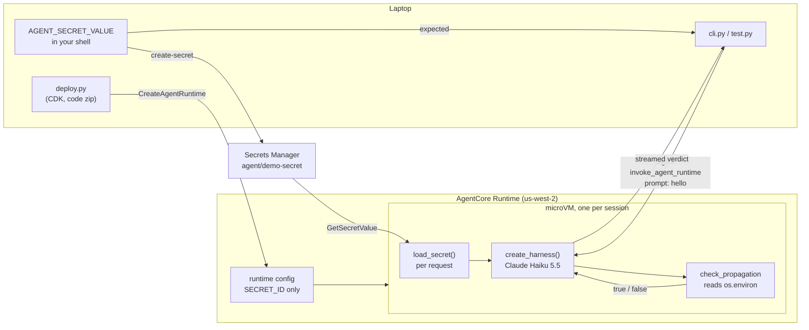

# Architecture: chapter 03

## Process

1. You store the value in the Secrets Manager secret `agent/demo-secret`.
2. `deploy.py` stages `agent.py` and its Linux arm64 wheels into a code zip, and deploys it with
   the CDK `agentcore.Runtime` construct. The runtime gets `SECRET_ID=agent/demo-secret`, never the
   value. The execution role can read that one secret, call the Haiku 5.5 inference profile, and
   write its own logs.
3. `cli.py` sends `{"prompt": "hello", "expected": <your shell value>}` with a SigV4-signed
   `invoke_agent_runtime` call.
4. `invoke()` first calls `load_secret()`, which reads the secret into `os.environ`. Then the
   agent calls `check_propagation(expected)`, and answers with the one word the tool returns.

## Why the test proves it

The value that the agent compares against comes only from Secrets Manager. The client value comes
only from the payload. A `true` therefore means that the two match, and a `false` for a wrong
value shows that the tool does not just return `true`. `test.py` runs both cases.

## Mapping to the 1Password design

| Part | This chapter | Guide |
| ---- | ------------ | ----- |
| Where the secret lives | Secrets Manager | A 1Password vault item |
| What Secrets Manager holds | The secret | The 1Password service account token |
| What fetches it per request | `load_secret()` | `op run` |
| Who reads the value | One tool, in the agent process | The Strands Box egress gateway; the agent gets a placeholder |
| Rotation | Next request, no redeploy | Next request, no redeploy |
