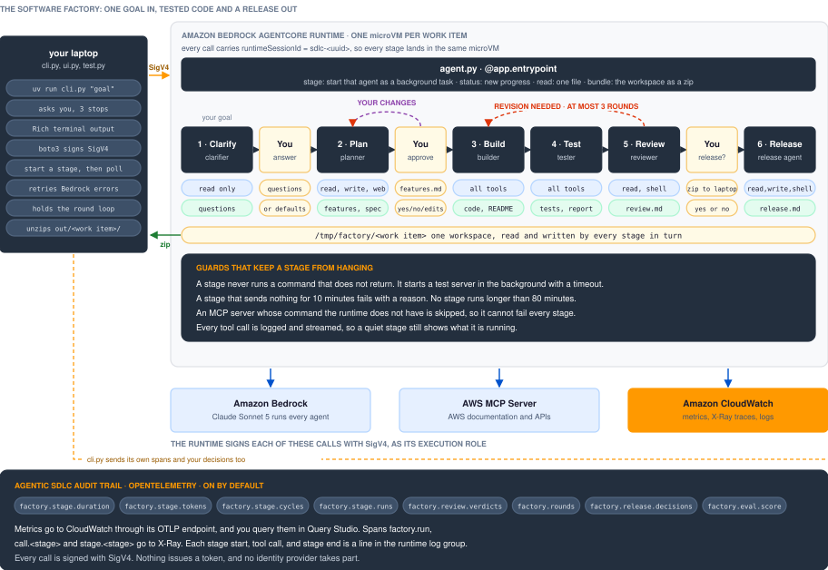
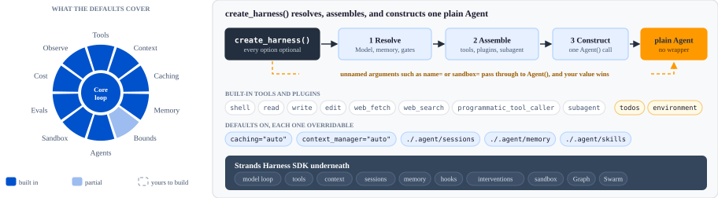

# A software factory on AgentCore Runtime

This chapter turns one product goal into tested code and a release. Six AI agents do the work in turn on Amazon Bedrock AgentCore Runtime. You stay in control at three points: you answer the agents' questions, you approve the feature list, and you approve the release.

## Process



You run one command on your laptop, for example `uv run cli.py "a task tracker MVP with projects, tasks, workflow, assignment and a summary"`. These things then happen:

1. The clarifier agent reads your goal and returns up to five questions, each with a default answer. You press Enter to keep a default, or you type your own answer.
2. The planner agent writes `features.md`, `requirements.md`, and `spec.md`. The terminal shows `features.md` and asks `Build these features?`. You answer yes, no, or the changes you want. If you ask for changes, the planner revises the plan and shows the list again.
3. The builder agent writes the code. The tester agent writes and runs the tests, and it writes `test-report.md`. The reviewer agent grades the work. If the reviewer asks for changes, the work goes back to the builder, for three rounds at most.
4. When the reviewer approves, `cli.py` downloads the code to `out/<work item>.zip` and unzips it to `out/<work item>/`. The terminal shows each source file with syntax highlighting.
5. The terminal shows `review.md` and asks `Release this work item?`. If you answer yes, the release agent writes `release.md`, and `cli.py` downloads the code again.

While a stage runs, the terminal shows each tool call on one line and a progress line every minute. A goal with five features takes about 15 to 30 minutes. Every stage also writes an audit trail to CloudWatch.

## Components

`cli.py` is the program you run. It holds the whole process: the order of the stages, the review loop, and the three stops for you. It starts each stage with one SigV4-signed call to the runtime, then polls the runtime every 5 seconds until the stage ends. `ui.py` draws the terminal output with Rich. `test.py` runs the same process with a built-in goal and then checks the result.

AgentCore Runtime runs `agent.py`. It gives each work item its own microVM, which is a small virtual machine with its own CPU, memory, and disk. `cli.py` uses the work item id as the `runtimeSessionId` of every call, so every stage of one work item runs in the same microVM. The microVM ends when the session ends, and its files go with it.

`agent.py` is the runtime code. One entrypoint accepts a stage to start, or a command: `status` returns new progress, `read` returns one file, and `bundle` returns the workspace as a zip. A stage runs as a background task, because one call to the runtime must end within 15 minutes and a build can take longer.

Each stage is one Strands harness agent with its own instructions and tool list. The clarifier can only read. The planner can read, write, and fetch web pages, but it has no shell. The builder and the tester have every tool. The reviewer has `read` and `shell`, so it can run the tests but cannot change the code it grades. Appendix A explains the harness.

The workspace is the folder `/tmp/factory/<work item>` on the microVM disk. Each stage reads the files that the earlier stages wrote and adds its own. This is how the planner hands the spec to the builder, and how the builder hands the code to the reviewer.

The agents call two AWS services as the runtime execution role. Amazon Bedrock runs Claude Sonnet 5 for every agent. The AWS MCP Server gives the agents AWS documentation and AWS APIs.

`telemetry.py` sends the audit trail with OpenTelemetry. Metrics such as `factory.stage.duration`, `factory.stage.tokens`, and `factory.review.verdicts` go to the CloudWatch OTLP endpoint. Spans go to X-Ray, and each stage start, tool call, and stage end is a line in the runtime log group. `cli.py` sends its own spans and your answers at the three stops.

## SigV4 authentication

Every call in this chapter is signed with SigV4, the AWS request signing scheme. The runtime has no authorizer, and nothing issues a token. Boto3 signs `invoke_agent_runtime` with the credentials you already use for the AWS CLI, so signing in to AWS on your laptop is the whole client setup. AWS recommends SigV4 for service-to-service calls inside AWS, and a JWT when end users sign in through an identity provider ([security best practices for AgentCore Runtime](https://docs.aws.amazon.com/bedrock-agentcore/latest/devguide/runtime-security-best-practices.html)).

Two identities take part in every run:

| Identity | Signs | Needs permission for |
| --- | --- | --- |
| You, on the laptop | The calls into the runtime | `bedrock-agentcore:InvokeAgentRuntime` on the runtime and on its endpoint |
| The runtime execution role, in the microVM | Every AWS call that an agent makes | Bedrock for Claude Sonnet 5, CloudWatch, and the AWS MCP Server |

AWS checks the invoke against both the runtime and the endpoint, so the caller policy must name both ([resource-based policies](https://docs.aws.amazon.com/bedrock-agentcore/latest/devguide/resource-based-policies.html)). Deny `InvokeAgentRuntimeForUser`, because it lets a caller claim a user identity that no identity provider checks.

```json
{
  "Version": "2012-10-17",
  "Statement": [
    {
      "Sid": "InvokeTheFactory",
      "Effect": "Allow",
      "Action": "bedrock-agentcore:InvokeAgentRuntime",
      "Resource": [
        "arn:aws:bedrock-agentcore:us-west-2:111122223333:runtime/software_factory-*",
        "arn:aws:bedrock-agentcore:us-west-2:111122223333:runtime/software_factory-*/endpoint/*"
      ]
    },
    {
      "Sid": "NoUserIdDelegation",
      "Effect": "Deny",
      "Action": "bedrock-agentcore:InvokeAgentRuntimeForUser",
      "Resource": "*"
    }
  ]
}
```

Any code in the microVM can act as the execution role, and that includes the builder's shell. The microVM keeps one session away from another. It does not keep the agent away from its own role. So `deploy.py` gives the role only what the stages need, and the people who can invoke the runtime must be at least as trusted as the role.

## Code walkthrough

`agent.py` defines each stage as an entry in `STAGES`: the instructions, the tool list, and whether the agent keeps a harness session between rounds. Only the builder keeps one, so its second attempt remembers the first.

```python
STAGES = {
    "review": {
        "tools": ["read", "shell"],  # it grades the work, so it cannot edit it
        "session": False,
        "instructions": """Grade the code in this directory against requirements.md, ...
End your reply with the single word APPROVED, or with the words REVISION NEEDED.""",
    },
    # clarify, plan, build, test and release have the same shape
}
```

`build_stage()` turns one entry into an agent. It puts a shared contract in front of each stage's instructions, for example "never run a command that does not return". It also adds the AWS MCP tools.

```python
def build_stage(stage: str, work_item: str, mcp_servers: dict | None):
    spec = STAGES[stage]
    return create_harness(
        model=MODEL_ID,
        instructions=f"{CONTRACT}\n\n{spec['instructions']}",
        builtin_tools=spec["tools"],
        tools=tools(),
        mcp_servers=runnable(mcp_servers) or None,
        session={"id": work_item, "dir": str(WORKSPACE / ".sessions")} if spec["session"] else False,
        memory=False,        # the workspace is the memory, and it is readable
        interventions=None,  # headless: an approval prompt here would never be answered
        callback_handler=None,
    )
```

The entrypoint answers every call at once. A stage call starts `run_stage()` as a background task and returns `started`. `run_stage()` calls `app.add_async_task()`, which keeps the microVM alive while the stage works. It also stops a stage that is silent for 10 minutes.

```python
@app.entrypoint
async def invoke(payload: dict):
    command = payload.get("command")
    if command == "status":   # the text written since the caller's offset, and the result
        ...
    if command == "bundle":   # the workspace as a base64 zip
        ...
    WORK[work_item] = {"stage": stage, "status": "running", "text": [], "result": {}, "error": ""}
    asyncio.create_task(run_stage(stage, work_item, task, payload.get("mcp_servers")))
    yield {"type": "started", "stage": stage, "work_item": work_item}
```

`cli.py` holds the only loop in the design. Each stage is one call to start it, then a poll for `status`. The review loop is a `for` statement, and the three stops for you are ordinary prompts between the calls.

```python
goal = clarify(agentcore, arn, work_item, goal, servers, auto_yes)       # stop 1
if not plan(agentcore, arn, work_item, goal, servers, auto_yes):        # stop 2
    return 2
verdict, _ = build_rounds(agentcore, arn, work_item, servers)           # 3 rounds at most
download(agentcore, arn, work_item, out)                                # out/<work item>.zip
if release_gate(agentcore, arn, work_item, auto_yes).lower() in YES:    # stop 3
    stage(agentcore, arn, work_item, "release", "Write release.md.", servers)
```

## Deploy

1. Install [uv](https://docs.astral.sh/uv/) and Node.js, and sign in to AWS. The examples use `us-west-2`.
2. Bootstrap CDK once in the account and Region with `npx aws-cdk bootstrap`.
3. Run `uv sync`, then `uv run deploy.py`. `deploy.py` builds the code zip for ARM64 and deploys the `SoftwareFactory` stack. It needs no container.
4. Run `uv run test.py --yes`. A good run ends with `PASS: the factory ran the full cycle`.
5. Run `npx aws-cdk destroy` to remove the stack.

## Appendix A: What Strands harness is

Strands harness is a thin composition layer over the Strands Harness SDK. The SDK holds the model loop, tools, context management, sessions, memory, and hooks. The harness assembles those pieces into one agent with tested defaults and a tuned system prompt. The factory, `create_harness()` in Python or `createHarness()` in TypeScript, works in three steps. It resolves your options into SDK objects, such as a `Model` from a `provider/name` string, a memory manager, and intervention handlers. It assembles the built-in tools, plugins, subagents, and behaviors. It then constructs a plain `Agent`, and nothing wraps that agent afterward ([Compose with the Strands Harness SDK](https://strandsagents.com/docs/user-guide/harness/composing-with-sdk/)).



Every factory option is optional ([configuration reference](https://strandsagents.com/docs/user-guide/harness/reference/configuration/)). The default model is `bedrock/global.anthropic.claude-opus-4-8` with reasoning on. Prompt caching and context management are on, and sessions, long-term memory, and Agent Skills live under `./.agent/`. [AWS reports](https://strandsagents.com/blog/introducing-strands-harness/) that the context defaults drove most of a 28% lower token cost than other harnesses on the same models.

### The seams you build on

Three seams let you change the agent and keep the harness. First, any argument that the factory does not name passes straight to the `Agent` constructor, and your explicit value wins over the default. That is how `name`, `sandbox`, or `system_prompt` reach the agent. Second, the returned agent is yours to change after construction, including `agent.system_prompt` and the tools. Third, the harness exports what it composes: `HARNESS_CONTRACT`, `build_system_prompt`, and in Python `resolve_memory` and `resolve_interventions`. An agent built from raw SDK blocks can still use the tuned prompt through `build_system_prompt`.

Use the raw SDK when the agent has a shape that the harness does not assume. Examples are a tool set with no shell, a custom agent loop, and an orchestration of many agents. Because the harness returns a plain `Agent`, you move only that part to the SDK and keep the rest.
