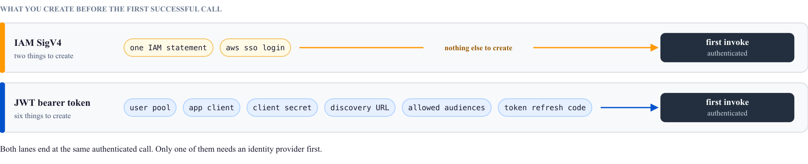
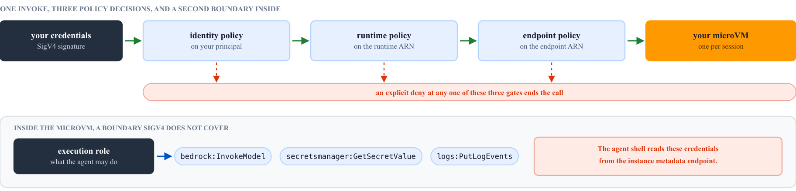
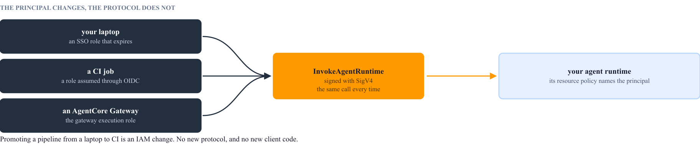

# IAM SigV4 for agents: the fast path is also the secure one

*A three page argument, and one page on where the credential comes from. Built from the official Amazon Bedrock AgentCore documentation.*

## What SigV4 is in this setting

SigV4, or Signature Version 4, is the scheme AWS uses to sign API requests. The caller derives a signature from its access key, the request itself, the region, and the service name. AWS checks that signature, works out which principal sent it, and then authorizes the call through IAM. A principal here is an IAM user or an IAM role.

AgentCore Runtime accepts either SigV4 or a JWT bearer token from an identity provider, and one runtime uses one method at a time. AWS recommends SigV4 for service-to-service calls inside AWS. It recommends the token path when end users authenticate directly through an identity provider ([security best practices for AgentCore Runtime](https://docs.aws.amazon.com/bedrock-agentcore/latest/devguide/runtime-security-best-practices.html)).

The consequence that decides the argument is this. SigV4 needs no code from you, because every AWS SDK signs every request already. A call to `invoke_agent_runtime` is signed the moment you make it, using whatever credentials the default chain finds.

<div class="figure">

</div>

## Why the inner loop gets shorter

The cost of the token path is not the runtime setting. It is the bootstrap in front of it. Before your first successful call you create a user pool, an app client, and a client secret. You also create an authorizer with a discovery URL and an allowed audience list. Then you write client code that fetches a token and refreshes it before it expires. None of that work is agent work, and all of it stands between you and the first response.

The SigV4 path reuses a credential you already hold. Boto3 checks a fixed list of places, called the default credential chain, and signs with the first credential it finds. `aws sso login` is the entry point this guide recommends, but it is one of several, and the last section lists them all. The entire client setup is one IAM statement attached to the principal that the chain finds.

A second effect matters more than the minutes saved. A token bootstrap built for speed usually ends with a long-lived secret sitting in a file, because refresh handling is the part people postpone. SigV4 has no such halfway state when the chain finds a role, because role credentials expire on their own. The chain also accepts an IAM user access key, which never expires, so the last section shows how to check which one you are using.

A third effect is quieter and still useful. The same credentials cover the model, because the agent calls Amazon Bedrock with SigV4 as well. One login covers both the invoke and the inference, so a laptop that can reach the model can also reach the agent.

## What does not get weaker

SigV4 is not authentication switched off. It routes the call into IAM, which is the most examined authorization engine AWS operates. The speed comes from skipping a bootstrap, not from skipping a check.

AgentCore authorizes an invoke against two resources, the agent runtime and the agent endpoint, and it evaluates both identity-based and resource-based policies on each one. A request succeeds when some policy permits it and no policy denies it. An explicit deny anywhere ends the call ([resource-based policies](https://docs.aws.amazon.com/bedrock-agentcore/latest/devguide/resource-based-policies.html)). So the caller policy has to name both ARNs.

<div class="figure">

</div>

```json
{
  "Version": "2012-10-17",
  "Statement": [
    {
      "Sid": "InvokeMyAgent",
      "Effect": "Allow",
      "Action": "bedrock-agentcore:InvokeAgentRuntime",
      "Resource": [
        "arn:aws:bedrock-agentcore:us-west-2:111122223333:runtime/my-agent-*",
        "arn:aws:bedrock-agentcore:us-west-2:111122223333:runtime/my-agent-*/endpoint/*"
      ]
    },
    {
      "Sid": "NoUserIdDelegation",
      "Effect": "Deny",
      "Action": "bedrock-agentcore:InvokeAgentRuntimeForUser",
      "Resource": "*"
    }
  ]
}
```

Auditing comes free with this choice. Every invoke lands in CloudTrail attributed to the identity that signed it. On a token path with one shared development client, every engineer on the team looks like the same caller in the log. On SigV4 they do not, because each one signs as a different role.

Tightening is ordinary IAM work rather than new machinery. Attach a resource-based policy to the runtime to name exactly which principals can invoke it. Use the `bedrock-agentcore:subnets` and `bedrock-agentcore:securityGroups` condition keys to require approved VPCs. Put `aws:SourceArn` and `aws:SourceAccount` in the execution role trust policy to prevent a confused deputy. A confused deputy is a service tricked into using its own permissions for the wrong caller.

Two managed shortcuts undo this if you leave them in place. `BedrockAgentCoreFullAccess` grants broad permissions, including `GetWorkloadAccessTokenForUserId`, so copy the statements you need instead. The policies the AgentCore CLI creates are for development and testing. AWS says plainly that they do not suit production ([IAM permissions for AgentCore Runtime](https://docs.aws.amazon.com/bedrock-agentcore/latest/devguide/runtime-permissions.html)).

One boundary sits outside all of this, and missing it is the real risk. Front-door authentication says nothing about what the agent does once it is running. That is the execution role, and any code inside the microVM can read its credentials from the instance metadata endpoint. The agent's own shell can read them too. The microVM separates one session from another. It does not separate the agent from the role the agent runs as. Grant the execution role only what that agent needs. Keep the principals who can invoke the runtime at least as privileged as the role itself.

## Promotion costs an IAM change, not a rewrite

The identity you test with on a laptop is the identity you later restrict. Nothing else about the call changes when the caller does.

<div class="figure">

</div>

On your laptop the principal is an SSO role that expires in hours. In continuous integration it is a role assumed through OIDC, so the build holds no stored key either. Behind an AgentCore Gateway it is the gateway execution role, and the runtime resource policy names that role and nothing else. The client code is the same `invoke_agent_runtime` call in all three cases.

That last case needs the restriction to be explicit. A gateway gives you policy-based authorization, guardrails, and request interceptors, and all of them only hold if traffic actually goes through the gateway. For a SigV4 runtime, attach a resource-based policy that allows the gateway execution role alone. Without it, any principal with the invoke permission reaches the runtime directly and walks past every control the gateway applies.

## Where SigV4 stops being the answer

SigV4 authenticates AWS principals, and your end users are not AWS principals. As soon as a browser session has to reach the agent directly, you need the token path. One runtime carries one method at a time, so that means a second runtime or a second version. Planning the split early costs less than retrofitting it.

The grant is also larger than it looks. Handing somebody AWS credentials so that they can reach an agent gives them an AWS identity. That is correct for developers and for build systems. It is wrong for a customer.

`InvokeAgentRuntimeForUser` is not a way around this. It lets the caller assert a user identity as an opaque string, and no identity provider inspects that string. AWS scopes it to development and to architectures that resolve identity somewhere upstream. Treat it as a development convenience and deny it everywhere else.

| Question | IAM SigV4 | JWT bearer token |
| --- | --- | --- |
| Who is the caller | An AWS principal, such as your SSO role or a CI role | An end user, or an application holding a token |
| Setup before the first call | One IAM statement | Identity provider, client, secret, authorizer, refresh code |
| Client code you write | None, because the SDK signs | Fetch the token, cache it, refresh it |
| Credential lifetime | Short lived from SSO or a role. An IAM user key never expires | Whatever the provider issues, plus your refresh logic |
| Who appears in CloudTrail | The exact principal that signed | The client, which is often shared |
| Best fit | Local development, CI, service-to-service, gateway fronting | A product with signed-in human users |

## The whole setup

Two commands and one policy, starting from an agent runtime that already exists. `dev` is a placeholder for an IAM Identity Center profile in your `~/.aws/config`, and `AWSReservedSSO_Developer_abc123` is a placeholder for the role that profile signs you in as. If you have no such profile, `aws configure sso` creates one. An administrator usually attaches the policy, because the role belongs to Identity Center.

```bash
unset AWS_ACCESS_KEY_ID AWS_SECRET_ACCESS_KEY AWS_SESSION_TOKEN   # an exported key wins over the profile
aws sso login --profile dev
aws iam put-role-policy --role-name AWSReservedSSO_Developer_abc123 \
  --policy-name InvokeMyAgent --policy-document file://invoke-policy.json
```

Then call the agent from the same shell with `AWS_PROFILE=dev` set. Boto3 reads the profile, signs the request, and AgentCore authorizes it. The session id must be 33 characters or longer, so a prefixed UUID is a safe habit.

```python
import boto3, json, uuid

client = boto3.client("bedrock-agentcore")                 # region from your profile
response = client.invoke_agent_runtime(
    agentRuntimeArn="arn:aws:bedrock-agentcore:us-west-2:111122223333:runtime/my-agent-a1b2",
    runtimeSessionId=f"dev-{uuid.uuid4()}",                 # 33 characters or longer
    qualifier="DEFAULT",
    payload=json.dumps({"prompt": "Summarize the open issues."}).encode())
print(json.loads(response["response"].read()))
```

There is no token to obtain, no secret to store, and no refresh path to maintain. The credential expires on its own, and the call appears in CloudTrail under your name. The same code runs unchanged in continuous integration, once a role there holds the same statement.
## Where the credential comes from

You never tell boto3 which credential to use. It checks a fixed list of entry points, called the default credential chain, and stops at the first one that returns a credential. The table gives the order in botocore 1.43, which is the library under boto3 and the AWS CLI, so both find the same credential ([boto3 credentials guide](https://boto3.amazonaws.com/v1/documentation/api/latest/guide/credentials.html)).

| Step | Entry point | What puts a credential there | Expires |
| --- | --- | --- | --- |
| 1 | Environment variables | `AWS_ACCESS_KEY_ID` and `AWS_SECRET_ACCESS_KEY`, exported by a shell profile or a CI step | Only if `AWS_SESSION_TOKEN` is also set |
| 2 | Assume role | `role_arn` with `source_profile` or `credential_source` in `~/.aws/config` | Yes, the SDK refreshes it |
| 3 | Web identity | `AWS_WEB_IDENTITY_TOKEN_FILE` and `AWS_ROLE_ARN`, set by EKS service accounts | Yes |
| 4 | IAM Identity Center | an `sso_session` profile, filled by `aws sso login` | Yes, after hours |
| 5 | Shared credentials file | keys saved in `~/.aws/credentials` | Never, when it holds an IAM user key |
| 6 | Console login | a `login_session` profile, filled by `aws login` | Yes |
| 7 | External process | a `credential_process` command in the profile, such as a company sign-in tool | Whatever the command returns |
| 8 | Config file keys | keys saved in `~/.aws/config` | Never |
| 9 | Container | the task role on Amazon ECS, or EKS Pod Identity | Yes |
| 10 | Instance metadata | the instance profile on Amazon EC2 | Yes |

Two legacy providers, for old EC2 command line tools and for boto2 files, sit between steps 8 and 9. Almost no machine has them.

The order matters more than the list. A key that a shell profile exports is step 1, so it wins over an Identity Center profile at step 4, even right after a successful `aws sso login`. The call still succeeds, so nothing warns you. CloudTrail records an IAM user instead of your role, and every process that starts from that shell inherits a key that never expires. That includes any agent you run locally.

`AWS_PROFILE` chooses which profile steps 2 to 8 read, and it does not skip step 1. Only an explicit profile removes the environment variables from the chain: `boto3.Session(profile_name="dev")` in code, or `--profile dev` on the CLI. To stop using an exported key everywhere, delete the export from the shell profile and deactivate the key in IAM.

The chain is also why the same client code runs everywhere without a change. On a laptop the chain stops at step 4, 6, or 7. In GitHub Actions, the `configure-aws-credentials` action trades an OIDC token for role credentials and exports them with a session token, so step 1 answers with a credential that expires. On EKS step 3 or 9 answers, on ECS step 9, and on EC2 step 10. In AgentCore Runtime the chain finds the execution role that the runtime gives the agent.

To see which entry point answered, run two commands in the shell that runs the agent.

```bash
aws configure list            # the Type column names the source: env, sso, shared-credentials-file
aws sts get-caller-identity   # :user/ is a long-term key, :assumed-role/ is short lived
```

In Python, `boto3.Session().get_credentials().method` returns the same source name. If the source is `env` or `shared-credentials-file` and the identity ends in `:user/`, the agent signs with a key that never expires.
