# Strands Agents: a technical overview

*What an agent harness is, and how Strands maps each concept to concrete APIs, a CLI, and framework terms.*

---

## What a harness is

A language model takes a prompt and returns text, and it takes no action. An agent harness is the program around the model: it gives the model information and a fixed set of actions, runs the actions the model picks, returns the results, and repeats until the goal is met. Users experience the harness as "the agent", so two agents on the same model behave differently when their harnesses differ.

<div class="figure">
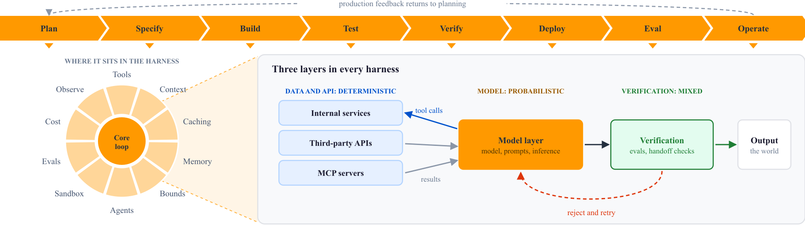
</div>

The top strip is the lifecycle of an agent, from Plan to Operate, and the dashed arc returns production feedback to planning. The wheel shows the concerns a harness adds around the core loop of the model. The right panel shows the three layers of every harness: model output passes through verification before it reaches the world, and a rejected result goes back for a retry. [Building Effective Agent Harnesses](building-effective-harnesses.md) covers each segment without reference to a framework.

| Layer | What it holds | Nature |
| --- | --- | --- |
| Model | The model, the prompts, the inference pattern | Probabilistic |
| Data and API | Internal services, third-party APIs, MCP servers | Deterministic |
| Verification | Evaluation, structured handoffs, rules for unverified data | Mixed |

Each layer fails differently. Ordinary software tests cover the data and API layer. Most teams skip the verification layer, so a small error in step two becomes a confident wrong answer in step nine. The amount of harness a task needs depends on how easily you can check its output: code has a built-in pass or fail signal, so its harness can stay light, and a task without that signal needs more verification, more structure, and more human checkpoints.

---

## How Strands builds a harness

Strands Agents is an open-source SDK for Python and TypeScript that implements each segment of the wheel. It is model-driven: you give an agent a model, tools, and a prompt, the model decides how to reach the goal, and the SDK runs the loop. Amazon Q Developer and AWS Glue use it in production, and version 1.0 shipped in July 2025. Strands works at two levels. The SDK gives each concern as a primitive that you connect, and the Strands Harness connects them for you: one `create_harness()` call returns an agent with a shell, file tools, web access, memory, prompt caching, and context management. The smallest SDK program below gets a default Amazon Bedrock model and context management, but no prompt caching, because caching is on by default only in `create_harness()`.

```python
from strands import Agent

agent = Agent()
agent("Summarize the last three AWS re:Invent keynotes.")
```

<div class="figure">
<table style="width:auto;max-width:560px;margin:0 auto;border-collapse:collapse;font-size:8.5pt;line-height:1.35">
<tr style="background:#232F3E;color:#ffffff"><th style="padding:4px 10px;text-align:left">Harness concept</th><th style="padding:4px 10px;text-align:left">Strands API, CLI, or term</th></tr>
<tr style="background:#f8f9fb"><td style="padding:3px 10px;border-bottom:1px solid #dfe1e6;background:#fff3e0;color:#9a5b00;font-weight:700;white-space:nowrap">Core loop</td><td style="padding:3px 10px;border-bottom:1px solid #dfe1e6"><code>Agent()</code>, <code>agent(...)</code>, <code>stream_async</code></td></tr>
<tr style="background:#ffffff"><td style="padding:3px 10px;border-bottom:1px solid #dfe1e6;background:#fff3e0;color:#9a5b00;font-weight:700;white-space:nowrap">Model</td><td style="padding:3px 10px;border-bottom:1px solid #dfe1e6"><code>BedrockModel</code>, <code>OpenAIModel</code>, 20+ providers</td></tr>
<tr style="background:#f8f9fb"><td style="padding:3px 10px;border-bottom:1px solid #dfe1e6;background:#fff3e0;color:#9a5b00;font-weight:700;white-space:nowrap">Tools</td><td style="padding:3px 10px;border-bottom:1px solid #dfe1e6"><code>@tool</code>, <code>strands.vended_tools</code>, MCP client</td></tr>
<tr style="background:#ffffff"><td style="padding:3px 10px;border-bottom:1px solid #dfe1e6;background:#fff3e0;color:#9a5b00;font-weight:700;white-space:nowrap">Context</td><td style="padding:3px 10px;border-bottom:1px solid #dfe1e6">sliding-window, summarizing, or null manager</td></tr>
<tr style="background:#f8f9fb"><td style="padding:3px 10px;border-bottom:1px solid #dfe1e6;background:#fff3e0;color:#9a5b00;font-weight:700;white-space:nowrap">Caching</td><td style="padding:3px 10px;border-bottom:1px solid #dfe1e6"><code>CacheConfig(strategy="auto")</code>, harness <code>caching="auto"</code></td></tr>
<tr style="background:#ffffff"><td style="padding:3px 10px;border-bottom:1px solid #dfe1e6;background:#fff3e0;color:#9a5b00;font-weight:700;white-space:nowrap">Memory and state</td><td style="padding:3px 10px;border-bottom:1px solid #dfe1e6">agent state, <code>FileSessionManager</code>, harness memory</td></tr>
<tr style="background:#f8f9fb"><td style="padding:3px 10px;border-bottom:1px solid #dfe1e6;background:#fff3e0;color:#9a5b00;font-weight:700;white-space:nowrap">Bounds</td><td style="padding:3px 10px;border-bottom:1px solid #dfe1e6"><code>Limits</code>, <code>interventions</code></td></tr>
<tr style="background:#ffffff"><td style="padding:3px 10px;border-bottom:1px solid #dfe1e6;background:#fff3e0;color:#9a5b00;font-weight:700;white-space:nowrap">Orchestration</td><td style="padding:3px 10px;border-bottom:1px solid #dfe1e6">agents as tools, <code>Swarm</code>, <code>GraphBuilder</code>, A2A</td></tr>
<tr style="background:#f8f9fb"><td style="padding:3px 10px;border-bottom:1px solid #dfe1e6;background:#fff3e0;color:#9a5b00;font-weight:700;white-space:nowrap">Sandbox</td><td style="padding:3px 10px;border-bottom:1px solid #dfe1e6"><code>DockerSandbox</code>, Strands Box, AgentCore microVM</td></tr>
<tr style="background:#ffffff"><td style="padding:3px 10px;border-bottom:1px solid #dfe1e6;background:#fff3e0;color:#9a5b00;font-weight:700;white-space:nowrap">Evals</td><td style="padding:3px 10px;border-bottom:1px solid #dfe1e6"><code>strands-evals validate</code>, <code>run --fail-on</code></td></tr>
<tr style="background:#f8f9fb"><td style="padding:3px 10px;border-bottom:1px solid #dfe1e6;background:#fff3e0;color:#9a5b00;font-weight:700;white-space:nowrap">Guardrails</td><td style="padding:3px 10px;border-bottom:1px solid #dfe1e6">hooks, steering, Agent Control, AgentCore Policy</td></tr>
<tr style="background:#ffffff"><td style="padding:3px 10px;border-bottom:1px solid #dfe1e6;background:#fff3e0;color:#9a5b00;font-weight:700;white-space:nowrap">Observability</td><td style="padding:3px 10px;border-bottom:1px solid #dfe1e6">OpenTelemetry export, <code>EventLoopMetrics</code></td></tr>
</table>
</div>

The figure below places the same components on the eight phases of the lifecycle from the first figure. Secure is not a phase: its controls run under every phase, so it spans the whole line.

<div class="figure">
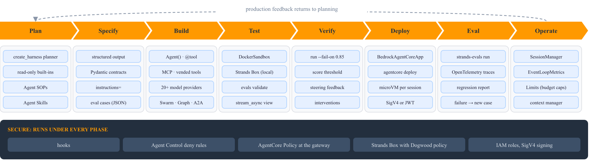
</div>

---

## The agent loop

Each call to an agent runs one or more cycles of the agent loop. A cycle sends the conversation to the model, receives a final answer or a request for tools, runs the tools, and adds the results to the conversation, and the loop starts another cycle until the model returns an answer, so one user turn can drive many rounds of model and tools. The loop also handles errors, records metrics for each cycle, enforces per-invocation budget caps so that a runaway agent stops, and raises an overflow error when the input grows past the context window. It is asynchronous, so independent tool calls and whole agents can run at the same time, and you can watch it as a stream of typed events (text, tool calls, reasoning) instead of waiting for one final string.

<div class="figure">
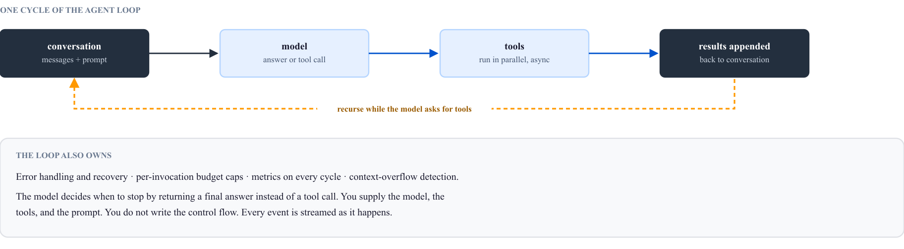
</div>

---

## Models: provider-agnostic by design

Every model reaches the agent through one `Model` interface, so the same agent code runs on any supported provider and each agent in a system can use a different model. More than 20 providers ship with the SDK, including Amazon Bedrock, Amazon Nova, Anthropic, OpenAI (Chat and Responses APIs), Google, Mistral, Writer, SageMaker, Ollama, llama.cpp, and LiteLLM, a gateway to many more. Community packages add NVIDIA NIM, vLLM, xAI, and others, and you can add your own provider by implementing the streaming method of `Model`. Streaming, tool calling, and structured output work the same on every first-party provider. Prompt caching varies: Amazon Bedrock, Anthropic, LiteLLM, and llama.cpp write cache points, and OpenAI and Google cache automatically on the server side.

<div class="figure">
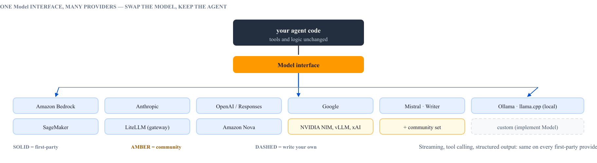
</div>

To switch providers, construct a different model class and pass it to the agent.

```python
from strands import Agent
from strands.models import BedrockModel
from strands.models.openai import OpenAIModel

bedrock = BedrockModel(model_id="us.amazon.nova-pro-v1:0", temperature=0.3, region_name="us-west-2")
openai = OpenAIModel(client_args={"api_key": "..."}, model_id="gpt-4o", params={"temperature": 0.7})

researcher = Agent(name="researcher", model=bedrock, tools=[web_fetch])
writer = Agent(name="writer", model=openai, tools=[document_formatter])
```

| Provider | Streaming | Tool calling | Structured output | Prompt caching |
| --- | --- | --- | --- | --- |
| Amazon Bedrock, Anthropic, LiteLLM, llama.cpp | yes | yes | yes | yes |
| OpenAI / Responses, Google | yes | yes | yes | automatic |
| Ollama, Mistral, Writer, SageMaker, Llama API | yes | yes | yes | no |
| Custom provider | yes | depends | depends | depends |

---

## Tools: how the model acts

A tool is a function that the model can call, and Strands accepts tools from four sources. Your own functions become tools with `@tool`: the SDK turns the typed signature and the docstring into the schema the model reads. The SDK vends ready tools in `strands.vended_tools`, among them `shell`, `file_editor`, `http_request`, `web_fetch`, `notebook`, and `handoff_to_user`, and the harness adds built-ins such as `web_search`. A Model Context Protocol (MCP) server, local or remote, adds its tools with no glue code, and other agents can be tools too, as the multi-agent section shows. The model decides when to call a tool and with which arguments, so you bound those choices with guardrails instead of scripting them.

<div class="figure">
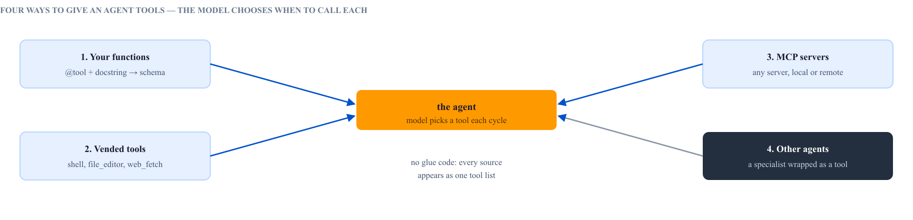
</div>

```python
from strands import Agent, tool
from strands.vended_tools import shell, file_editor

@tool
def ticket_status(ticket_id: str) -> str:
    """Return the current status of a support ticket by its ID."""
    return lookup(ticket_id)

agent = Agent(tools=[ticket_status, shell, file_editor])
```

---

## Context, state, and memory

An agent keeps three kinds of state. A conversation manager keeps the message list inside the context window, agent state holds structured data that tools read and write without spending context tokens, and a `SessionManager` persists both and restores them after a restart. The Strands Harness also turns on long-term memory by default and stores it under `./.agent/memory`.

<div class="figure">
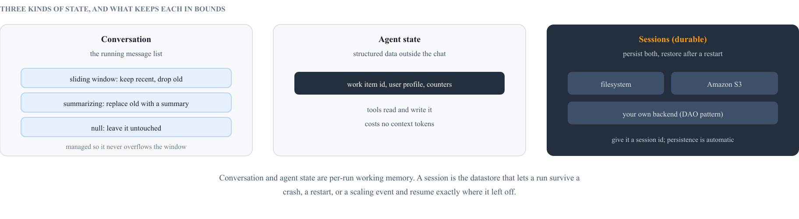
</div>

```python
from strands import Agent
from strands.session.file_session_manager import FileSessionManager

session = FileSessionManager(session_id="customer_support", base_dir="./sessions")
agent = Agent(id="support_bot_1", session_manager=session, tools=[knowledge_base])

agent("Help me reset my password.")        # saved as the turn completes
# ...after a restart, a new manager with the same id restores the whole history
```

## Structured output and streaming

Structured output makes the model return a typed object, such as a Pydantic model, so that another program can use the result without parsing prose. Streaming sends output as it is produced: `stream_async` yields events that you forward to a UI, with cancellation when the user leaves.

```python
async for event in agent.stream_async("Draft the release notes."):
    if "data" in event:
        print(event["data"], end="")
    elif "current_tool_use" in event:
        print(f"[calling {event['current_tool_use']['name']}]")
```

---

## Many agents working together

Strands has four multi-agent patterns. With agents as tools, an orchestrator keeps control and calls specialists wrapped in `@tool`. A swarm is a team that coordinates through shared memory with no fixed order. A graph runs nodes and conditional edges, for a process that needs the same steps every time. The Agent-to-Agent protocol (A2A) connects agents across organizations through a published agent card.

<div class="figure">
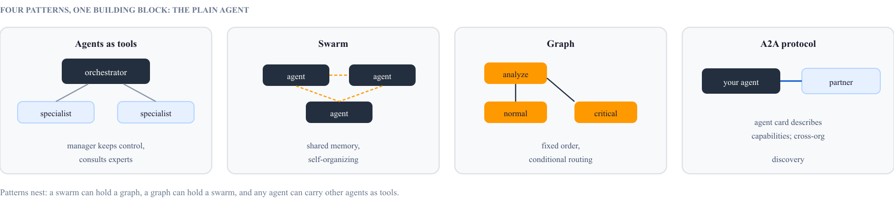
</div>

```python
from strands import Agent
from strands.multiagent import Swarm, GraphBuilder

team = Swarm([researcher, analyst, writer])          # self-organizing
team("Write a comprehensive report on the history of AI since 1950.")

builder = GraphBuilder()                             # deterministic
builder.add_node(analyzer, "analyze")
builder.add_node(normal, "normal"); builder.add_node(critical, "critical")
builder.add_edge("analyze", "normal", condition=is_routine)
builder.add_edge("analyze", "critical", condition=is_urgent)
builder.set_entry_point("analyze")
builder.build()("I need help with my order.")
```

---

## Guardrails: bounding a model that drives

The model picks the actions, so you cannot write a rule for every case in advance. Strands enforces control at runtime in the five layers below, from steering, which sends feedback so the model retries, to deny rules, which block the step. Agent Control is an open-source runtime control plane, and AgentCore Policy is the AWS service that enforces access control at the tool gateway.

<div class="figure">
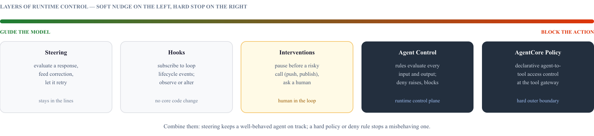
</div>

## Observability

Strands emits OpenTelemetry traces and metrics, so you can send them to any OpenTelemetry backend. The loop records tokens, latency, and tool calls for each cycle in `EventLoopMetrics`, and a call to an MCP server appears in the same trace as the model call that requested it.

---

## Evaluation: testing the agents themselves

Strands Evals tests changes to the agent itself, such as a new prompt, a smaller tool list, or a model upgrade. You write an experiment file of cases, each with an input and a way to score the output, and run it in continuous integration (CI). `validate` checks the file against its schema before any model call, and `run` executes the cases against an agent and fails the build when a `--fail-on` rule, such as a score threshold, is not met. Add each production failure to the suite as a new case. The package installs as `strands-agents-evals`.

```bash
strands-evals validate experiments/support.json
strands-evals run experiments/support.json --agent agents:responder \
  --fail-on threshold:0.85 -o support-report.json
```

<div class="figure">
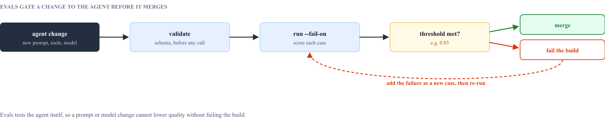
</div>

## Strands Box: a local policy sandbox

Strands Box is an open-source local sandbox for agents, in developer preview, that works with any model and any framework. It uses kernel isolation for one purpose: to make a single user-space policy layer the only way out of the sandbox. Every shell command, Python call, MCP call, file access, and network request passes through that layer, where Dogwood, an open policy language, allows or denies each action. The check is per tool and deterministic, so you can write rules such as "allow `git push` only if tests passed in the last 15 minutes" or "allow the payments API up to $100 a day".

<div class="figure">
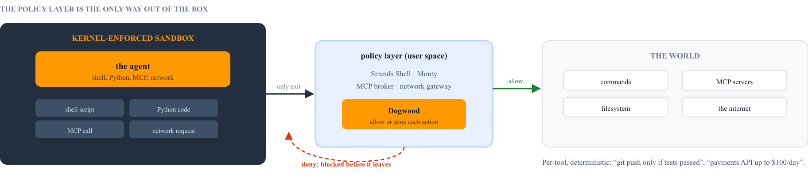
</div>

Box is the local counterpart of the AgentCore microVM: the microVM isolates a hosted session, and Box isolates and governs an agent on your laptop. Its policy engine uses the same technology as AgentCore Policy, which uses the Cedar policy language in the cloud. The [03-strands-box-harness](../03-strands-box-harness/README.md) sample runs an agent inside Strands Box.

---

## The layered stack: SDK, harness, and the tools around it

`create_harness()` resolves your options, adds the built-in tools and plugins, and returns a plain `Agent`. Every option has a default that you can override, so you start fast and drop to the raw SDK when your agent has a shape the harness does not expect. Agent Skills (instructions on disk that an agent loads when needed), Strands Evals, and Agent SOPs (procedures in natural language) sit beside the stack.

<div class="figure">
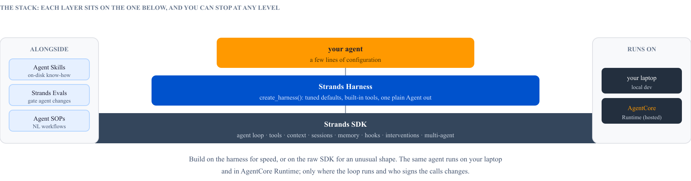
</div>

```python
from strands_harness import create_harness

# a planner that cannot run code: no shell, read and write only
planner = create_harness(name="planner", builtin_tools=["read", "write", "web_fetch", "web_search"],
                         instructions="Turn the issue into a spec with acceptance tests. Write no code.")
```

---

## Running agents in production

The usual production target is Amazon Bedrock AgentCore Runtime, a serverless host that gives each session its own microVM (a small virtual machine destroyed when the session ends). The microVM is the sandbox, so a deployed agent needs no extra sandbox for its shell. The runtime contract is to build for ARM64, listen on port 8080, and answer `POST /invocations` and `GET /ping`. The `BedrockAgentCoreApp` wrapper turns an agent function into that service, and the AgentCore CLI builds the image, pushes it to Amazon ECR, and creates the runtime.

<div class="figure">
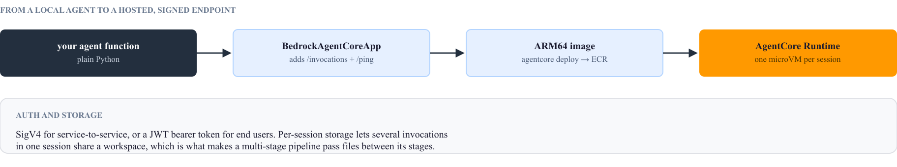
</div>

The samples in this repo put these pieces to work. [01-simple-strands-harness](../01-simple-strands-harness/README.md) deploys a harness agent to AgentCore Runtime and tests it end to end. [03-strands-box-harness](../03-strands-box-harness/README.md) runs an agent inside Strands Box. [05-software-factory](../05-software-factory/README.md) runs a multi-stage pipeline with evals.

## Where to start

Start with one agent, one model, and two or three tools. Add a session manager when the agent must survive a restart, structured output when another program reads the result, and agents as tools when one scope of work becomes two, then move to a swarm or a graph as coordination grows. Add guardrails before the agent can do anything expensive, and tracing before it runs where you cannot watch it. Each step is an argument to the same `Agent`, so the smallest program and the production system have the same shape.

Primary sources: the Strands Agents documentation and SDK reference at [strandsagents.com](https://strandsagents.com/), the [1.0 release announcement](https://strandsagents.com/blog/strands-agents-1-0/), the [model providers guide](https://strandsagents.com/docs/user-guide/sdk/model-providers/), the [multi-agent guides](https://strandsagents.com/docs/user-guide/sdk/multi-agent/graph/), and the [Agent Control runtime guardrails announcement](https://strandsagents.com/blog/strands-agents-with-agent-control/).
